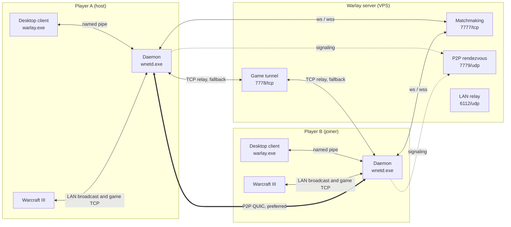
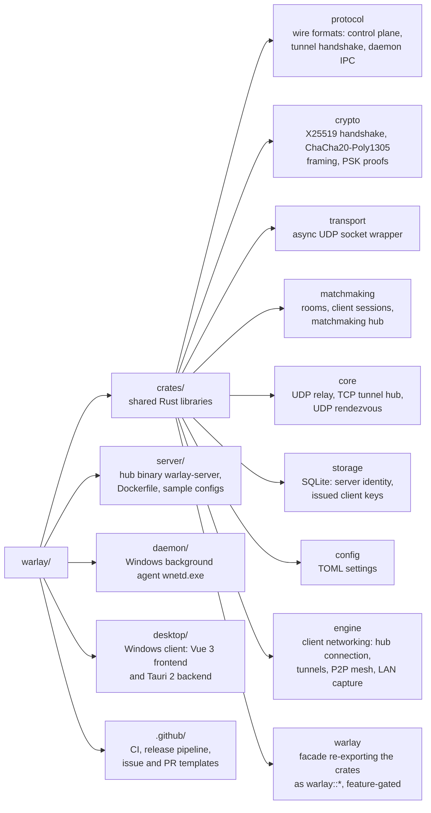

<div align="center">

# Warlay

**Play Warcraft III LAN games with people who are not on your network**<br/>
No third-party VPN, no port forwarding on the players' side.

[](https://github.com/jhonsferg/warlay/actions/workflows/ci.yml)
[](https://github.com/jhonsferg/warlay/releases/latest)
[](LICENSE)

[](https://www.rust-lang.org)
[](https://tokio.rs)
[](https://tauri.app)
[](https://vuejs.org)
[](https://www.typescriptlang.org)
[](https://vite.dev)
[](https://pinia.vuejs.org)
[](https://sass-lang.com)
[](https://www.sqlite.org)
[](https://www.docker.com)
[](https://github.com/features/actions)

[](#downloads)
[](#downloads)

</div>

Warlay pairs a small server you run on a VPS with a Windows desktop client.
Players register the server, create or join rooms in real time, and Warlay
makes the host's game show up in everyone's in-game _Local Area Network_
screen, then carries the real game session either directly between players
(P2P over QUIC) or through the server as a fallback.

## Contents

- [Features](#features)
- [How it works](#how-it-works)
- [Downloads](#downloads)
- [Quick start](#quick-start)
- [Repository layout](#repository-layout)
- [Building from source](#building-from-source)
- [Testing](#testing)
- [Releases](#releases)
- [Contributing](#contributing)
- [License](#license)

## Features

- **Rooms in real time** - create, list, join and password-protect rooms;
  every change is pushed over WebSocket, no polling.
- **Real LAN discovery** - the host's actual W3GS broadcast is captured off
  the wire and replayed on each player's network, so the game lists it exactly
  as if everyone shared a LAN.
- **Game-session tunnel** - direct peer-to-peer QUIC with NAT hole punching,
  falling back automatically to a TCP relay through the server.
- **Secure by default** - per-session X25519 + ChaCha20-Poly1305 encryption on
  the control plane, server-issued client keys, and optional TLS (`wss://`)
  for both the control plane and the game tunnel.
- **Text and voice chat** - room chat, private messages, and Opus voice chat
  between room members.
- **Legacy LAN-mesh mode** - bridge broadcast traffic between isolated subnets
  (for example an Android hotspot running the server on Termux).

## How it works



| Component                       | Runs on                             | Role                                                    |
| ------------------------------- | ----------------------------------- | ------------------------------------------------------- |
| [`server/`](server/README.md)   | VPS (Linux, macOS, Windows, Docker) | Matchmaking hub, game-session relay, P2P rendezvous.    |
| [`daemon/`](daemon/README.md)   | Player's PC (Windows, elevated)     | `wnetd.exe`: LAN capture/replay, game tunnel, P2P mesh. |
| [`desktop/`](desktop/README.md) | Player's PC (Windows)               | `warlay.exe`: the user interface (Tauri 2 + Vue 3).     |

### Network ports (server)

| Port | Protocol | Purpose                                       |
| ---- | -------- | --------------------------------------------- |
| 7777 | TCP      | WebSocket matchmaking control plane (`/ws`)   |
| 7778 | TCP      | Game-session tunnel (relay fallback)          |
| 7779 | UDP      | P2P rendezvous (signaling only, no game data) |
| 6112 | UDP      | LAN discovery relay                           |

Behind a TLS reverse proxy the usual mapping is `443 -> 7777` (`wss://`) and
`7443 -> 7778` (TLS tunnel); see [server/README.md](server/README.md#tls-with-a-reverse-proxy).

### Server addresses

The client accepts three address forms:

| Address                     | Transport                                                                                                  |
| --------------------------- | ---------------------------------------------------------------------------------------------------------- |
| `wss://hub.example.com`     | TLS for matchmaking (port 443) and for the game tunnel (port 7443), certificate verified. **Recommended.** |
| `ws://hub.example.com:7777` | Plain WebSocket and plain game tunnel (port 7778).                                                         |
| `hub.example.com:7777`      | Same as `ws://`, kept for compatibility.                                                                   |

## Downloads

Every release on the [Releases page](https://github.com/jhonsferg/warlay/releases/latest) ships:

| Artifact                                         | Platform                                                                      |
| ------------------------------------------------ | ----------------------------------------------------------------------------- |
| `warlay-desktop-vX.Y.Z-windows-x64-setup.exe`    | Windows installer (client + daemon)                                           |
| `warlay-desktop-vX.Y.Z-windows-x64-portable.zip` | Portable client + daemon                                                      |
| `warlay-daemon-vX.Y.Z-windows-x64.zip`           | Daemon only                                                                   |
| `warlay-server-vX.Y.Z-<target>.tar.gz` / `.zip`  | Server for Linux (static x64/ARM64), macOS (Intel/Apple Silicon), Windows x64 |
| `ghcr.io/jhonsferg/warlay-server:X.Y.Z`          | Server Docker image                                                           |
| `SHA256SUMS.txt`                                 | Checksums for every file                                                      |

## Quick start

### Run a server

```sh
docker volume create warlay-data
docker run -d --name warlay-hub --restart unless-stopped \
  -p 7777:7777/tcp -p 7778:7778/tcp -p 7779:7779/udp -p 6112:6112/udp \
  -v warlay-data:/app/data \
  ghcr.io/jhonsferg/warlay-server:latest
```

Or download a server archive and run `./warlay-server hub --config config/hub.toml`.
Configuration, TLS and deployment details are in [server/README.md](server/README.md).

### Play

1. Install `warlay-desktop-...-setup.exe` (or unzip the portable build and
   run `warlay.exe`). Accept the UAC prompt: the daemon needs administrator
   rights to capture LAN traffic.
2. Register the server (`wss://your-domain` or `host:7777`).
3. Create a room, or join one, and start Warcraft III from the room panel.
4. The host creates the game in _Local Area Network_; it appears for every
   room member.

## Repository layout



The binaries (`server`, `daemon`, `desktop/src-tauri`) stay thin: protocol,
crypto and networking logic live in `crates/` and are consumed through the
`warlay` facade with only the features each binary needs. The server never
links the Windows-only `engine` crate.

## Building from source

Requirements: Rust stable, Node.js 20+, and on Windows the MSVC build tools.
The server builds on any platform; the daemon and the desktop client need
Windows.

```sh
# Server
cargo build --release -p server            # -> target/release/warlay-server
docker build -t warlay-hub -f server/Dockerfile .

# Desktop client + daemon + installer (Windows)
cd desktop
npm ci
npx tauri build                             # also builds the daemon sidecar
npm run build-portable-zip
```

## Testing

```sh
# Server and shared crates (any OS)
cargo test -p server -p protocol -p crypto -p matchmaking -p core -p storage -p config -p transport

# Whole workspace (Windows; the daemon's test binary requires an elevated shell)
cargo test --workspace

# Frontend type-check and bundle
cd desktop && npm run build

# Live tests against a deployed hub (opt-in)
cargo test -p engine -- --ignored
```

## Releases

Releases are fully automated. `main` is protected, and every pull request
merged into it triggers the [release workflow](.github/workflows/release.yml),
which:

1. computes the next [SemVer](https://semver.org) version from the
   [Conventional Commits](https://www.conventionalcommits.org) since the last
   tag (`feat` -> minor, `fix` and others -> patch, breaking -> major),
2. builds the server for five targets and the Windows client, daemon and
   installer with that version stamped in,
3. pushes the server image to GHCR,
4. tags the commit and publishes a GitHub Release with notes and checksums.

## Contributing

Contributions are welcome. Please read [CONTRIBUTING.md](CONTRIBUTING.md) and
our [Code of Conduct](CODE_OF_CONDUCT.md). Report security issues privately as
described in [SECURITY.md](SECURITY.md).

## License

Warlay is released under the [MIT License](LICENSE). Warcraft III is a
trademark of Blizzard Entertainment; this project is not affiliated with or
endorsed by Blizzard.
