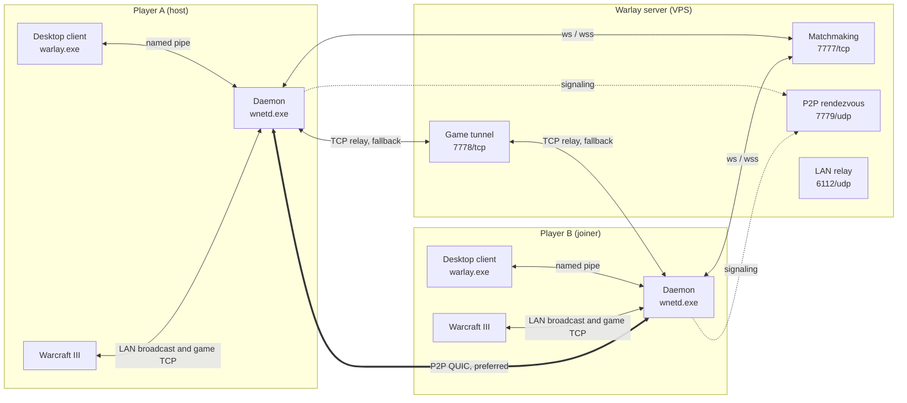
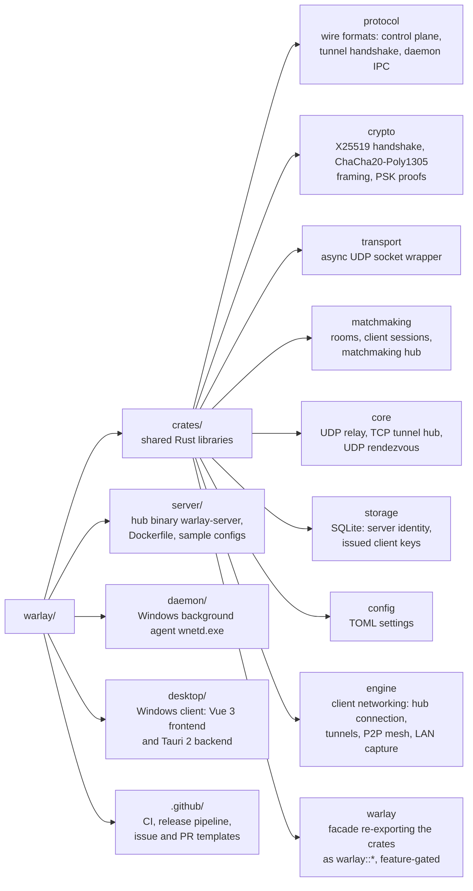
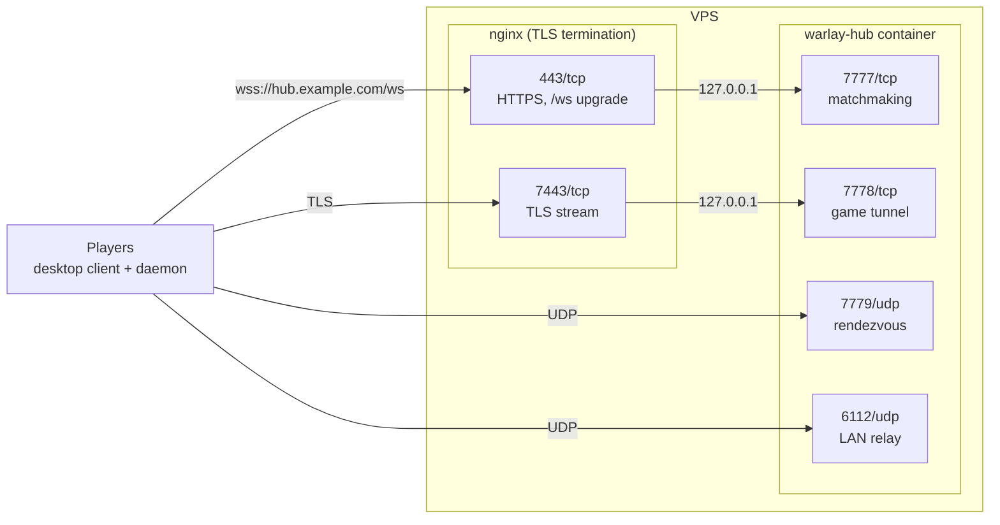
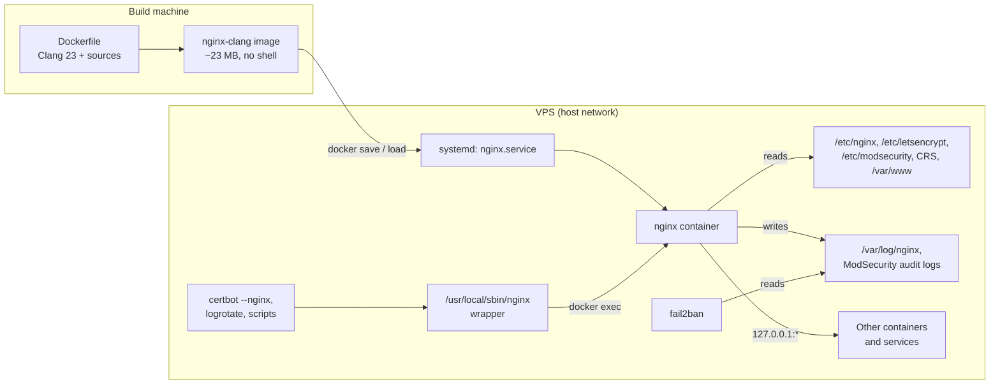

<div align="center">

# Warlay

**Play Warcraft III LAN games with people who are not on your network**<br/>
No third-party VPN, no port forwarding on the players' side.

[](https://github.com/jhonsferg/warlay/actions/workflows/ci.yml)
[](https://github.com/jhonsferg/warlay/releases/latest)
[](LICENSE)

[](https://www.rust-lang.org)
[](https://tokio.rs)
[](https://tauri.app)
[](https://vuejs.org)
[](https://www.typescriptlang.org)
[](https://vite.dev)
[](https://pinia.vuejs.org)
[](https://sass-lang.com)
[](https://www.sqlite.org)
[](https://www.docker.com)
[](https://github.com/features/actions)

[](#downloads)
[](#downloads)

</div>

Warlay pairs a small server you run on a VPS with a Windows desktop client.
Players register the server, create or join rooms in real time, and Warlay
makes the host's game show up in everyone's in-game _Local Area Network_
screen, then carries the real game session either directly between players
(P2P over QUIC) or through the server as a fallback.

## Contents

- [Features](#features)
- [How it works](#how-it-works)
- [Downloads](#downloads)
- [Quick start](#quick-start)
- [Repository layout](#repository-layout)
- [Building from source](#building-from-source)
- [Installing the desktop client](#installing-the-desktop-client)
- [Deploying the server on a VPS](#deploying-the-server-on-a-vps)
- [Operating the server](#operating-the-server)
- [Testing](#testing)
- [Releases](#releases)
- [Contributing](#contributing)
- [License](#license)

## Features

- **Rooms in real time** - create, list, join and password-protect rooms;
  every change is pushed over WebSocket, no polling.
- **Real LAN discovery** - the host's actual W3GS broadcast is captured off
  the wire and replayed on each player's network, so the game lists it exactly
  as if everyone shared a LAN.
- **Game-session tunnel** - direct peer-to-peer QUIC with NAT hole punching,
  falling back automatically to a TCP relay through the server.
- **Secure by default** - per-session X25519 + ChaCha20-Poly1305 encryption on
  the control plane, server-issued client keys, and optional TLS (`wss://`)
  for both the control plane and the game tunnel.
- **Text and voice chat** - room chat, private messages, and Opus voice chat
  between room members.
- **Legacy LAN-mesh mode** - bridge broadcast traffic between isolated subnets
  (for example an Android hotspot running the server on Termux).

## How it works



| Component                       | Runs on                             | Role                                                    |
| ------------------------------- | ----------------------------------- | ------------------------------------------------------- |
| [`server/`](server/README.md)   | VPS (Linux, macOS, Windows, Docker) | Matchmaking hub, game-session relay, P2P rendezvous.    |
| [`daemon/`](daemon/README.md)   | Player's PC (Windows, elevated)     | `wnetd.exe`: LAN capture/replay, game tunnel, P2P mesh. |
| [`desktop/`](desktop/README.md) | Player's PC (Windows)               | `warlay.exe`: the user interface (Tauri 2 + Vue 3).     |

### Network ports (server)

| Port | Protocol | Purpose                                       |
| ---- | -------- | --------------------------------------------- |
| 7777 | TCP      | WebSocket matchmaking control plane (`/ws`)   |
| 7778 | TCP      | Game-session tunnel (relay fallback)          |
| 7779 | UDP      | P2P rendezvous (signaling only, no game data) |
| 6112 | UDP      | LAN discovery relay                           |

Behind a TLS reverse proxy the usual mapping is `443 -> 7777` (`wss://`) and
`7443 -> 7778` (TLS tunnel); see [server/README.md](server/README.md#tls-with-a-reverse-proxy).

### Server addresses

The client accepts three address forms:

| Address                     | Transport                                                                                                  |
| --------------------------- | ---------------------------------------------------------------------------------------------------------- |
| `wss://hub.example.com`     | TLS for matchmaking (port 443) and for the game tunnel (port 7443), certificate verified. **Recommended.** |
| `ws://hub.example.com:7777` | Plain WebSocket and plain game tunnel (port 7778).                                                         |
| `hub.example.com:7777`      | Same as `ws://`, kept for compatibility.                                                                   |

## Downloads

Every release on the [Releases page](https://github.com/jhonsferg/warlay/releases/latest) ships:

| Artifact                                         | Platform                                                                      |
| ------------------------------------------------ | ----------------------------------------------------------------------------- |
| `warlay-desktop-vX.Y.Z-windows-x64-setup.exe`    | Windows installer (client + daemon)                                           |
| `warlay-desktop-vX.Y.Z-windows-x64-portable.zip` | Portable client + daemon                                                      |
| `warlay-daemon-vX.Y.Z-windows-x64.zip`           | Daemon only                                                                   |
| `warlay-server-vX.Y.Z-<target>.tar.gz` / `.zip`  | Server for Linux (static x64/ARM64), macOS (Intel/Apple Silicon), Windows x64 |
| `ghcr.io/jhonsferg/warlay-server:X.Y.Z`          | Server Docker image                                                           |
| `SHA256SUMS.txt`                                 | Checksums for every file                                                      |

## Quick start

### Run a server

```sh
docker volume create warlay-data
docker run -d --name warlay-hub --restart unless-stopped   -p 7777:7777/tcp -p 7778:7778/tcp -p 7779:7779/udp -p 6112:6112/udp   -v warlay-data:/app/data   ghcr.io/jhonsferg/warlay-server:latest
```

Players can then register `<server-ip>:7777`. For a production setup with a
domain, TLS and nginx, follow [Deploying the server on a VPS](#deploying-the-server-on-a-vps).

### Play

1. Install `warlay-desktop-...-setup.exe` (or unzip the portable build and
   run `warlay.exe`). Accept the UAC prompt: the daemon needs administrator
   rights to capture LAN traffic.
2. Register the server (`wss://your-domain` or `host:7777`).
3. Create a room, or join one, and start Warcraft III from the room panel.
4. The host creates the game in _Local Area Network_; it appears for every
   room member.

## Repository layout



The binaries (`server`, `daemon`, `desktop/src-tauri`) stay thin: protocol,
crypto and networking logic live in `crates/` and are consumed through the
`warlay` facade with only the features each binary needs. The server never
links the Windows-only `engine` crate.

## Building from source

### Prerequisites

| Tool                                                                                    | Needed for                       | Notes                                                                      |
| --------------------------------------------------------------------------------------- | -------------------------------- | -------------------------------------------------------------------------- |
| [Rust](https://rustup.rs) stable                                                        | everything                       | On Windows use the default `x86_64-pc-windows-msvc` toolchain.             |
| [Visual Studio Build Tools](https://visualstudio.microsoft.com/visual-cpp-build-tools/) | daemon, desktop client (Windows) | Workload **Desktop development with C++** (MSVC compiler and Windows SDK). |
| [Node.js](https://nodejs.org) 20 LTS or newer                                           | desktop client                   | Ships with `npm`.                                                          |
| [WebView2 Runtime](https://developer.microsoft.com/microsoft-edge/webview2/)            | running the desktop client       | Preinstalled on Windows 10 and 11.                                         |
| C toolchain (`build-essential` on Debian/Ubuntu, Xcode Command Line Tools on macOS)     | server on Linux/macOS            | Compiles the bundled SQLite and the `ring` crypto library.                 |
| [Docker](https://docs.docker.com/engine/install/)                                       | container image                  | Optional.                                                                  |

Nothing else is required: NSIS (the installer builder) is downloaded by the
Tauri CLI on first use, SQLite is compiled in, and the Opus voice codec is
linked statically from prebuilt libraries.

```sh
git clone https://github.com/jhonsferg/warlay.git
cd warlay
```

### Desktop client and daemon (Windows)

The client (`warlay.exe`) bundles the daemon (`wnetd.exe`) as a Tauri
sidecar, so a single build produces both.

**Development mode** - hot-reloading frontend on top of a debug build:

```powershell
cd desktop
npm ci
npm run prepare-daemon-sidecar   # builds wnetd.exe into src-tauri/binaries/
npm run tauri dev
```

**Installer** - a release build of the frontend, the daemon and the client,
packaged as an NSIS installer:

```powershell
cd desktop
npm ci
npx tauri build
```

`tauri build` runs `npm run build` (type-check and bundle the frontend) and
`npm run prepare-daemon-sidecar` (release build of the daemon) before
compiling the client. The results are in `target/release/` at the repository
root:

| Path                                                    | Content                                   |
| ------------------------------------------------------- | ----------------------------------------- |
| `target/release/bundle/nsis/Warlay_X.Y.Z_x64-setup.exe` | Installer (client + daemon + uninstaller) |
| `target/release/warlay.exe`                             | Desktop client                            |
| `target/release/wnetd.exe`                              | Daemon                                    |

**Portable build** - a zip with `warlay.exe`, `wnetd.exe` and usage notes,
for players who do not want to install anything:

```powershell
npm run build-portable-zip   # after npx tauri build
# -> target/release/bundle/nsis/Warlay_X.Y.Z_x64-portable.zip
```

**Daemon only:**

```powershell
cargo build --release -p daemon   # -> target/release/wnetd.exe
```

Binaries link the MSVC runtime statically, so they run on a clean Windows
installation. The version comes from `desktop/src-tauri/tauri.conf.json`
(installer and zip names) and the workspace `Cargo.toml`; the release
pipeline stamps both automatically.

> [!NOTE]
> The installer is not code-signed, so Windows SmartScreen shows a warning
> on first run (**More info > Run anyway**). To sign it, configure
> `bundle.windows.certificateThumbprint` in `tauri.conf.json` with your
> code-signing certificate.

### Server binary

The server builds on Linux, macOS and Windows:

```sh
cargo build --release -p server
# -> target/release/warlay-server (warlay-server.exe on Windows)
```

**Static Linux binary** - runs on any distribution regardless of its glibc
version, which is what the release archives ship. Build it with
[cross](https://github.com/cross-rs/cross) (needs Docker):

```sh
cargo install cross --locked
cross build --release -p server --target x86_64-unknown-linux-musl
cross build --release -p server --target aarch64-unknown-linux-musl   # ARM64 servers
# -> target/<target>/release/warlay-server
```

### Server container image

The image is built from the repository root, because the server depends on
the workspace crates:

```sh
docker build -t warlay-hub -f server/Dockerfile .
```

It uses `cargo-chef` to cache dependency builds and a distroless, non-root
runtime that contains only the stripped binary and `config/hub.toml`.
Building needs more than 1 GiB of RAM; on a small VPS, build on your own
machine and transfer the image:

```sh
docker save warlay-hub | gzip | ssh user@your-vps 'gunzip | docker load'
```

Every release also publishes the image as
`ghcr.io/jhonsferg/warlay-server:<version>` and `:latest`.

## Installing the desktop client

1. Download `warlay-desktop-vX.Y.Z-windows-x64-setup.exe` from the
   [latest release](https://github.com/jhonsferg/warlay/releases/latest) and
   run it (or unzip the portable build anywhere and run `warlay.exe`).
2. On first launch Windows asks for administrator permission for
   `wnetd.exe`. Accept it: the daemon needs elevation to capture LAN game
   broadcasts. The client starts the daemon every time it opens.
3. Register a server with the **+** button in the server rail, using the
   address its operator gave you, for example `wss://hub.example.com`.
4. Set the Warcraft III executable in **Settings**, then create or join a
   room.

Optional: to start the daemon at logon without opening the client, run
`wnetd.exe --install` from an elevated terminal in the installation folder
(`wnetd.exe --uninstall` removes it). Settings and logs are stored in
`%APPDATA%\com.warlay.lanlauncher\`. Uninstall from **Settings > Apps**; the
uninstaller stops the daemon first.

## Deploying the server on a VPS

This walkthrough deploys the hub with Docker behind nginx, with a domain
name and Let's Encrypt certificates, so players connect with
`wss://hub.example.com`. Replace `hub.example.com` with your own domain
throughout.



### 1. Requirements

- A VPS with a public IPv4 address running **Debian 12** or **Ubuntu 22.04+**
  (other distributions work with equivalent commands).
- 1 vCPU and 512 MiB of RAM are enough to run the hub. Building the image
  needs more, so build elsewhere or use the published image.
- A domain name whose DNS you control.
- Root or `sudo` access over SSH.

### 2. Prepare the system

```sh
sudo apt update && sudo apt upgrade -y
sudo apt install -y ufw fail2ban unattended-upgrades curl
sudo dpkg-reconfigure -plow unattended-upgrades   # automatic security updates
```

Use SSH keys and disable password logins (`PasswordAuthentication no` in
`/etc/ssh/sshd_config`) before exposing the server.

### 3. Install Docker

```sh
curl -fsSL https://get.docker.com | sudo sh
sudo systemctl enable --now docker
```

### 4. Point a domain at the VPS

Create DNS records for the hostname players will use:

| Type   | Name              | Value                           |
| ------ | ----------------- | ------------------------------- |
| `A`    | `hub.example.com` | the VPS IPv4 address            |
| `AAAA` | `hub.example.com` | the VPS IPv6 address (optional) |

If your domain already has a wildcard record (`*.example.com`) pointing at
this VPS, any subdomain works without new records. Check propagation before
continuing:

```sh
getent hosts hub.example.com
```

### 5. Configure the firewall

| Port | Protocol | Purpose                                      |
| ---- | -------- | -------------------------------------------- |
| 22   | TCP      | SSH                                          |
| 80   | TCP      | HTTP, Let's Encrypt validation and redirects |
| 443  | TCP      | `wss://` matchmaking through nginx           |
| 7443 | TCP      | TLS game tunnel through nginx                |
| 7779 | UDP      | P2P rendezvous                               |
| 6112 | UDP      | LAN discovery relay                          |

```sh
sudo ufw default deny incoming
sudo ufw default allow outgoing
sudo ufw allow 22/tcp
sudo ufw allow 80/tcp
sudo ufw allow 443/tcp
sudo ufw allow 7443/tcp
sudo ufw allow 7779/udp
sudo ufw allow 6112/udp
sudo ufw enable
```

> [!WARNING]
> Ports published by Docker bypass `ufw`. That is why the next step
> publishes 7777 and 7778 on `127.0.0.1` only: they must be reachable
> exclusively through nginx.

### 6. Run the hub container

Write the server configuration to the host so it survives image updates:

```sh
sudo mkdir -p /opt/warlay
sudo curl -fsSL -o /opt/warlay/hub.toml \
  https://raw.githubusercontent.com/jhonsferg/warlay/main/server/config/hub.toml
sudo chmod 644 /opt/warlay/hub.toml
```

Edit `/opt/warlay/hub.toml`: at least set `server_name` (the name players
see), and optionally `[security] password` to require a password on first
connection. See [server/README.md](server/README.md#configuration) for every
option. Then start the container:

```sh
docker volume create warlay-data
docker run -d --name warlay-hub --restart unless-stopped \
  -p 127.0.0.1:7777:7777/tcp \
  -p 127.0.0.1:7778:7778/tcp \
  -p 7779:7779/udp \
  -p 6112:6112/udp \
  -v warlay-data:/app/data \
  -v /opt/warlay/hub.toml:/app/config/hub.toml:ro \
  ghcr.io/jhonsferg/warlay-server:latest

docker logs warlay-hub   # "starting warlay-server (hub mode)"
```

The `warlay-data` volume holds `warlay.db`, the server identity and every
issued client key. Never run the container without it, or players have to
register again after every update.

### 7. Install nginx and the stream module

```sh
sudo apt install -y nginx libnginx-mod-stream certbot
```

`libnginx-mod-stream` adds TCP proxying, needed for the TLS game tunnel. If
you build nginx from source instead, follow
[Alternative: nginx in a container built from source](#alternative-nginx-in-a-container-built-from-source),
which already includes the stream module, and come back here. Add a `stream` block at the end of
`/etc/nginx/nginx.conf`, outside the `http` block:

```nginx
stream {
    include /etc/nginx/streams-enabled/*.conf;
}
```

```sh
sudo mkdir -p /etc/nginx/streams-available /etc/nginx/streams-enabled
```

### 8. Obtain a TLS certificate

Serve the ACME challenge over plain HTTP first. Create
`/etc/nginx/sites-available/hub.example.com.conf`:

```nginx
server {
    listen 80;
    listen [::]:80;
    server_name hub.example.com;

    location /.well-known/acme-challenge/ {
        root /var/www/html;
    }

    location / {
        return 301 https://$host$request_uri;
    }
}
```

Enable it and request the certificate:

```sh
sudo ln -s /etc/nginx/sites-available/hub.example.com.conf /etc/nginx/sites-enabled/
sudo nginx -t && sudo systemctl reload nginx
sudo certbot certonly --webroot -w /var/www/html -d hub.example.com \
  --deploy-hook "systemctl reload nginx"
```

The deploy hook reloads nginx after every automatic renewal, so both the
HTTPS and the stream listeners pick up the new certificate without dropping
active games. Verify renewal with `sudo certbot renew --dry-run`.

### 9. Configure nginx for Warlay

Append the HTTPS server to `/etc/nginx/sites-available/hub.example.com.conf`:

```nginx
server {
    listen 443 ssl;
    listen [::]:443 ssl;
    server_name hub.example.com;

    ssl_certificate     /etc/letsencrypt/live/hub.example.com/fullchain.pem;
    ssl_certificate_key /etc/letsencrypt/live/hub.example.com/privkey.pem;
    ssl_protocols TLSv1.2 TLSv1.3;

    # Matchmaking WebSocket. Clients ping every few seconds, the long
    # timeouts only matter for idle sessions.
    location = /ws {
        proxy_pass http://127.0.0.1:7777;
        proxy_http_version 1.1;
        proxy_set_header Upgrade $http_upgrade;
        proxy_set_header Connection "upgrade";
        proxy_set_header Host $host;
        proxy_set_header X-Real-IP $remote_addr;
        proxy_buffering off;
        proxy_read_timeout 1h;
        proxy_send_timeout 1h;
    }

    location / {
        return 404;
    }
}
```

Create `/etc/nginx/streams-available/warlay.conf` for the game tunnel:

```nginx
server {
    listen 7443 ssl;
    listen [::]:7443 ssl;

    ssl_certificate     /etc/letsencrypt/live/hub.example.com/fullchain.pem;
    ssl_certificate_key /etc/letsencrypt/live/hub.example.com/privkey.pem;
    ssl_protocols TLSv1.2 TLSv1.3;

    proxy_pass 127.0.0.1:7778;
    proxy_connect_timeout 5s;
    # A room host's control channel can stay idle for hours.
    proxy_timeout 12h;
    tcp_nodelay on;
}
```

Enable it and reload:

```sh
sudo ln -s /etc/nginx/streams-available/warlay.conf /etc/nginx/streams-enabled/
sudo nginx -t && sudo systemctl reload nginx
```

### 10. Verify the deployment

```sh
# WebSocket upgrade through nginx: expect "HTTP/1.1 101 Switching Protocols"
curl -si --http1.1 -m 5 \
  -H "Connection: Upgrade" -H "Upgrade: websocket" \
  -H "Sec-WebSocket-Version: 13" -H "Sec-WebSocket-Key: dGhlIHNhbXBsZSBub25jZQ==" \
  https://hub.example.com/ws | head -1

# TLS game tunnel: expect "Verify return code: 0 (ok)"
timeout 5 openssl s_client -connect hub.example.com:7443 -servername hub.example.com </dev/null 2>/dev/null \
  | grep "Verify return code"

# Hub logs
docker logs --tail 20 warlay-hub
```

Players can now register `wss://hub.example.com` in the desktop client.

### Alternative: without a domain

For a quick test or a private server, skip nginx and TLS and publish the
ports directly. Players then register `<vps-ip>:7777` (no transport
encryption beyond the built-in session encryption, see
[SECURITY.md](SECURITY.md)):

```sh
sudo ufw allow 7777/tcp && sudo ufw allow 7778/tcp
docker run -d --name warlay-hub --restart unless-stopped \
  -p 7777:7777/tcp -p 7778:7778/tcp -p 7779:7779/udp -p 6112:6112/udp \
  -v warlay-data:/app/data \
  ghcr.io/jhonsferg/warlay-server:latest
```

### Alternative: without Docker (systemd)

Download `warlay-server-vX.Y.Z-x86_64-unknown-linux-musl.tar.gz` (or the
`aarch64` one for ARM servers) from the releases page, then:

```sh
sudo useradd --system --home /opt/warlay --shell /usr/sbin/nologin warlay
sudo mkdir -p /opt/warlay/data
sudo tar -xzf warlay-server-v*-x86_64-unknown-linux-musl.tar.gz -C /opt/warlay --strip-components=1
sudo sed -i 's|^data_dir = .*|data_dir = "/opt/warlay/data"|' /opt/warlay/config/hub.toml
sudo sed -i 's|^ws_addr = .*|ws_addr = "127.0.0.1:7777"|; s|^tcp_tunnel_addr = .*|tcp_tunnel_addr = "127.0.0.1:7778"|' \
  /opt/warlay/config/hub.toml
sudo chown -R warlay:warlay /opt/warlay
```

Create `/etc/systemd/system/warlay.service`:

```ini
[Unit]
Description=Warlay hub
After=network-online.target
Wants=network-online.target

[Service]
User=warlay
Group=warlay
WorkingDirectory=/opt/warlay
ExecStart=/opt/warlay/warlay-server hub --config /opt/warlay/config/hub.toml
Restart=on-failure
NoNewPrivileges=true
ProtectSystem=strict
ProtectHome=true
ReadWritePaths=/opt/warlay/data

[Install]
WantedBy=multi-user.target
```

```sh
sudo systemctl daemon-reload
sudo systemctl enable --now warlay
journalctl -u warlay -f
```

The nginx, certificate and firewall steps are the same as above.

### Alternative: nginx in a container built from source

When nginx on the VPS is the shared entry point for several services, as in
the deployment this guide is based on (other APIs, MinIO, a Git server and
Warlay behind one nginx with ModSecurity, Brotli and GeoIP2), it can run as a
container built entirely from upstream sources with Clang. The container
keeps the host's configuration, certificates, logs and tooling untouched, can
be replaced or removed in seconds, and nothing in it comes from a package
manager at runtime.



#### Why host networking

The container runs with `--network host`, not with published ports:

| Concern                           | Published ports (`-p 80:80 ...`)                                      | `--network host`               |
| --------------------------------- | --------------------------------------------------------------------- | ------------------------------ |
| Upstreams on `127.0.0.1:<port>`   | Unreachable: inside the container `127.0.0.1` is the container itself | Work unchanged                 |
| Real client IP (GeoIP, logs, WAF) | Can be replaced by the Docker gateway (userland proxy, IPv6)          | Always preserved               |
| fail2ban / ufw bans               | Bypassed: traffic goes through Docker's `FORWARD` chain, not `INPUT`  | Applied as before              |
| Performance                       | NAT and conntrack on every connection                                 | Same network stack as the host |

Containers share the host kernel, so CPU, memory and system calls run at
native speed; with host networking there is no extra network layer either.

#### Build the image

Build on a workstation, not on a small VPS: the image compiles LLVM-built
OpenSSL, libmodsecurity (C++) and nginx with LTO. The Dockerfile is a
multi-stage build:

| Stage       | Content                                                                                                                             |
| ----------- | ----------------------------------------------------------------------------------------------------------------------------------- |
| `toolchain` | Clang/LLVM, `lld` and LLVM's binutils from the official LLVM release (GPG verified), CMake from Kitware (SHA-256 verified), pkgconf |
| `deps`      | OpenSSL, PCRE2, zlib, libmaxminddb, yajl, libxml2, brotli and libmodsecurity compiled from their upstream sources                   |
| `nginx`     | nginx and its dynamic modules, ThinLTO, stripped                                                                                    |
| `rootfs`    | the only shared libraries the binaries load (glibc, libcrypt, libstdc++, libgcc) from fully patched Debian 12 packages              |
| `runtime`   | `FROM scratch`: rootfs + nginx, no shell, no package manager                                                                        |

| Component         | Version     | Source and verification                           |
| ----------------- | ----------- | ------------------------------------------------- |
| Clang/LLVM        | 23.1.3      | github.com/llvm/llvm-project release, GPG         |
| CMake             | 4.4.4       | github.com/Kitware/CMake release, SHA-256         |
| pkgconf           | 3.0.8       | distfiles.ariadne.space                           |
| nginx             | 1.31.6      | nginx.org, GPG (developer keys)                   |
| OpenSSL           | 3.5.9 (LTS) | github.com/openssl/openssl, SHA-256               |
| PCRE2             | 10.49       | github.com/PCRE2Project/pcre2                     |
| zlib              | 1.3.2       | github.com/madler/zlib                            |
| libmaxminddb      | 1.14.1      | github.com/maxmind/libmaxminddb                   |
| brotli            | 1.2.0       | github.com/google/brotli                          |
| yajl              | 2.1.0       | github.com/lloyd/yajl                             |
| libxml2           | 2.15.4      | download.gnome.org, SHA-256                       |
| libmodsecurity    | 3.0.17      | github.com/owasp-modsecurity/ModSecurity, SHA-256 |
| ModSecurity-nginx | 1.0.4       | github.com/owasp-modsecurity/ModSecurity-nginx    |
| headers-more      | 0.40        | github.com/openresty/headers-more-nginx-module    |
| ngx_brotli        | `a71f931`   | github.com/google/ngx_brotli                      |
| geoip2 module     | 3.4         | github.com/leev/ngx_http_geoip2_module            |

Build decisions worth knowing before changing the Dockerfile:

- **No `-march=native`.** Many VPS expose a generic virtual CPU (for example
  "QEMU Virtual CPU" without SSE4.2); a binary tuned for the build machine
  dies with an illegal instruction there. Check `/proc/cpuinfo` on the
  target before raising the baseline.
- **LLVM all the way.** The build uses `lld`, `llvm-ar`, `llvm-ranlib` and
  friends exposed under their classic names, so no GNU binutils are needed.
  apt is used once, in the toolchain stage, for the glibc and libstdc++
  development headers, which define the target system's ABI.
- **Static dependencies.** OpenSSL, PCRE2 and zlib are compiled into nginx;
  libmaxminddb and brotli into their modules; yajl, libxml2 and PCRE2 into
  libmodsecurity. At runtime nginx needs only `libc` and `libcrypt`, and
  libmodsecurity only `libstdc++`.
- **OpenSSL hardening.** `no-ssl3 no-weak-ssl-ciphers`; TLS compression is
  not enabled (CRIME).
- **yajl** is compiled directly with Clang because its 2014 CMake files no
  longer configure with CMake 4, and gets a `yajl.pc` so libmodsecurity's
  `configure` finds the static library (its manual search only looks for
  shared ones). libmodsecurity is configured with `pkg-config --static` so
  private dependencies such as `-lm` are linked too.
- **Only the modules in use.** Perl, XSLT, image filter, legacy GeoIP and
  mail modules are not built, which also drops their dependencies.

<details>
<summary>Dockerfile</summary>

```dockerfile
# syntax=docker/dockerfile:1
#
# nginx built with Clang/LLVM from upstream sources: the compiler, CMake,
# OpenSSL, PCRE2, zlib, brotli, libmaxminddb, yajl, libxml2 and
# libmodsecurity all come from their original projects, not from apt.
# apt is used once, in the toolchain stage, for the glibc and libstdc++
# development headers -- those define the system ABI and cannot be swapped.
#
# Target: Debian 12 hosts (glibc 2.36), generic x86-64 CPUs (no -march).
#   docker build -t nginx-clang:1.31.6 .

ARG DEBIAN=debian:12

# ---------------------------------------------------------------------------
FROM ${DEBIAN} AS toolchain
ARG LLVM_VERSION=23.1.3
ARG CMAKE_VERSION=4.4.4
ENV DEBIAN_FRONTEND=noninteractive
RUN apt-get update \
 && apt-get install -y --no-install-recommends \
      libc6-dev libgcc-12-dev libstdc++-12-dev make perl xz-utils curl ca-certificates gnupg \
 && rm -rf /var/lib/apt/lists/*

WORKDIR /src
RUN set -eux; \
    tar=LLVM-${LLVM_VERSION}-Linux-X64.tar.xz; \
    base=https://github.com/llvm/llvm-project/releases/download/llvmorg-${LLVM_VERSION}; \
    curl -fsSLO "$base/$tar"; curl -fsSLO "$base/$tar.sig"; \
    curl -fsSL https://releases.llvm.org/release-keys.asc | gpg -q --import; \
    gpg -q --verify "$tar.sig" "$tar"; \
    tar -xJf "$tar" -C /opt; rm -f "$tar" "$tar.sig"; \
    ln -s /opt/LLVM-${LLVM_VERSION}-Linux-X64 /opt/llvm; \
    mkdir -p /opt/llvm-toolchain/bin; \
    for t in ld:ld.lld ar:llvm-ar ranlib:llvm-ranlib nm:llvm-nm strip:llvm-strip objcopy:llvm-objcopy readelf:llvm-readelf; do \
      ln -s "/opt/llvm/bin/${t#*:}" "/opt/llvm-toolchain/bin/${t%%:*}"; \
    done

RUN set -eux; \
    tar=cmake-${CMAKE_VERSION}-linux-x86_64.tar.gz; \
    base=https://github.com/Kitware/CMake/releases/download/v${CMAKE_VERSION}; \
    curl -fsSLO "$base/$tar"; curl -fsSL -o cmake.sha256 "$base/cmake-${CMAKE_VERSION}-SHA-256.txt"; \
    sha256sum --ignore-missing -c cmake.sha256; \
    tar -xzf "$tar" -C /opt; rm -f "$tar" cmake.sha256; \
    ln -s /opt/cmake-${CMAKE_VERSION}-linux-x86_64 /opt/cmake

ENV PATH=/opt/llvm-toolchain/bin:/opt/llvm/bin:/opt/cmake/bin:/opt/pkgconf/bin:$PATH \
    CC=clang CXX=clang++ AR=llvm-ar NM=llvm-nm RANLIB=llvm-ranlib \
    CFLAGS="-O2 -fPIC -fstack-protector-strong" \
    CXXFLAGS="-O2 -fPIC -fstack-protector-strong" \
    PKG_CONFIG_PATH=/opt/nginx-deps/lib/pkgconfig:/opt/nginx-deps/lib64/pkgconfig

# pkgconf (pkg-config implementation), needed by libmodsecurity's configure.
ARG PKGCONF_VERSION=3.0.8
RUN set -eux; \
    curl -fsSLO https://distfiles.ariadne.space/pkgconf/pkgconf-${PKGCONF_VERSION}.tar.xz; \
    tar -xJf pkgconf-${PKGCONF_VERSION}.tar.xz; \
    cd pkgconf-${PKGCONF_VERSION}; \
    LDFLAGS="-fuse-ld=lld" ./configure --prefix=/opt/pkgconf --disable-shared; \
    make -j"$(nproc)"; make install; \
    ln -s pkgconf /opt/pkgconf/bin/pkg-config; \
    cd /src; rm -rf pkgconf-${PKGCONF_VERSION}*; \
    pkg-config --version

# ---------------------------------------------------------------------------
FROM toolchain AS deps
ARG OPENSSL_VERSION=3.5.9
ARG PCRE2_VERSION=10.49
ARG ZLIB_VERSION=1.3.2
ARG MAXMINDDB_VERSION=1.14.1
ARG BROTLI_VERSION=1.2.0
ARG YAJL_VERSION=2.1.0
ARG LIBXML2_VERSION=2.15.4
ARG MODSECURITY_VERSION=3.0.17
ENV DEPS=/opt/nginx-deps
WORKDIR /src

# Sources consumed directly by nginx's configure (built static into nginx).
RUN set -eux; \
    curl -fsSLO https://github.com/openssl/openssl/releases/download/openssl-${OPENSSL_VERSION}/openssl-${OPENSSL_VERSION}.tar.gz; \
    curl -fsSLO https://github.com/openssl/openssl/releases/download/openssl-${OPENSSL_VERSION}/openssl-${OPENSSL_VERSION}.tar.gz.sha256; \
    echo "$(cut -d' ' -f1 openssl-${OPENSSL_VERSION}.tar.gz.sha256)  openssl-${OPENSSL_VERSION}.tar.gz" | sha256sum -c; \
    curl -fsSLO https://github.com/PCRE2Project/pcre2/releases/download/pcre2-${PCRE2_VERSION}/pcre2-${PCRE2_VERSION}.tar.gz; \
    curl -fsSLO https://github.com/madler/zlib/releases/download/v${ZLIB_VERSION}/zlib-${ZLIB_VERSION}.tar.gz; \
    for t in openssl-${OPENSSL_VERSION} pcre2-${PCRE2_VERSION} zlib-${ZLIB_VERSION}; do tar -xzf $t.tar.gz; done

# PCRE2 again as a static PIC library, for libmodsecurity.
RUN set -eux; \
    cmake -S pcre2-${PCRE2_VERSION} -B build-pcre2 -DCMAKE_BUILD_TYPE=Release -DCMAKE_INSTALL_PREFIX=$DEPS \
      -DBUILD_SHARED_LIBS=OFF -DCMAKE_POSITION_INDEPENDENT_CODE=ON -DPCRE2_SUPPORT_JIT=ON \
      -DPCRE2_BUILD_PCRE2GREP=OFF -DPCRE2_BUILD_TESTS=OFF; \
    cmake --build build-pcre2 -j"$(nproc)"; cmake --install build-pcre2; rm -rf build-pcre2

RUN set -eux; \
    curl -fsSLO https://github.com/maxmind/libmaxminddb/releases/download/${MAXMINDDB_VERSION}/libmaxminddb-${MAXMINDDB_VERSION}.tar.gz; \
    tar -xzf libmaxminddb-${MAXMINDDB_VERSION}.tar.gz; \
    cmake -S libmaxminddb-${MAXMINDDB_VERSION} -B build-mmdb -DCMAKE_BUILD_TYPE=Release -DCMAKE_INSTALL_PREFIX=$DEPS \
      -DBUILD_SHARED_LIBS=OFF -DCMAKE_POSITION_INDEPENDENT_CODE=ON -DBUILD_TESTING=OFF; \
    cmake --build build-mmdb -j"$(nproc)"; cmake --install build-mmdb; rm -rf build-mmdb

# yajl's 2014-era CMakeLists no longer configures with CMake 4, and the
# library is a handful of C files: compile it directly.
RUN set -eux; \
    curl -fsSL -o yajl.tar.gz https://github.com/lloyd/yajl/archive/refs/tags/${YAJL_VERSION}.tar.gz; \
    tar -xzf yajl.tar.gz; \
    mkdir -p $DEPS/include/yajl $DEPS/lib build-yajl; \
    cp yajl-${YAJL_VERSION}/src/api/*.h $DEPS/include/yajl/; \
    major=${YAJL_VERSION%%.*}; rest=${YAJL_VERSION#*.}; minor=${rest%%.*}; micro=${rest#*.}; \
    sed -e "s/\${YAJL_MAJOR}/$major/" -e "s/\${YAJL_MINOR}/$minor/" -e "s/\${YAJL_MICRO}/$micro/" \
      yajl-${YAJL_VERSION}/src/api/yajl_version.h.cmake > $DEPS/include/yajl/yajl_version.h; \
    for f in yajl-${YAJL_VERSION}/src/*.c; do \
      clang $CFLAGS -I$DEPS/include -c "$f" -o "build-yajl/$(basename "$f" .c).o"; \
    done; \
    llvm-ar rcs $DEPS/lib/libyajl.a build-yajl/*.o; \
    rm -rf build-yajl; \
    mkdir -p $DEPS/lib/pkgconfig; \
    printf '%s\n' "prefix=$DEPS" 'libdir=${prefix}/lib' 'includedir=${prefix}/include' '' \
      'Name: yajl' 'Description: Yet Another JSON Library' "Version: ${YAJL_VERSION}" \
      'Cflags: -I${includedir}' 'Libs: -L${libdir} -lyajl' > $DEPS/lib/pkgconfig/yajl.pc; \
    pkg-config --modversion yajl

RUN set -eux; \
    minor=${LIBXML2_VERSION%.*}; \
    curl -fsSLO https://download.gnome.org/sources/libxml2/$minor/libxml2-${LIBXML2_VERSION}.tar.xz; \
    curl -fsSLO https://download.gnome.org/sources/libxml2/$minor/libxml2-${LIBXML2_VERSION}.sha256sum; \
    sha256sum --ignore-missing -c libxml2-${LIBXML2_VERSION}.sha256sum; \
    tar -xJf libxml2-${LIBXML2_VERSION}.tar.xz; \
    cmake -S libxml2-${LIBXML2_VERSION} -B build-xml2 -DCMAKE_BUILD_TYPE=Release -DCMAKE_INSTALL_PREFIX=$DEPS \
      -DBUILD_SHARED_LIBS=OFF -DCMAKE_POSITION_INDEPENDENT_CODE=ON \
      -DLIBXML2_WITH_PYTHON=OFF -DLIBXML2_WITH_ZLIB=OFF -DLIBXML2_WITH_LZMA=OFF -DLIBXML2_WITH_ICU=OFF \
      -DLIBXML2_WITH_TESTS=OFF -DLIBXML2_WITH_PROGRAMS=OFF -DLIBXML2_WITH_DOCS=OFF; \
    cmake --build build-xml2 -j"$(nproc)"; cmake --install build-xml2; rm -rf build-xml2

RUN set -eux; \
    curl -fsSL -o brotli.tar.gz https://github.com/google/brotli/archive/refs/tags/v${BROTLI_VERSION}.tar.gz; \
    tar -xzf brotli.tar.gz

# libmodsecurity as a shared library with its dependencies linked in
# statically: the runtime image needs nothing but libstdc++.
RUN set -eux; \
    base=https://github.com/owasp-modsecurity/ModSecurity/releases/download/v${MODSECURITY_VERSION}; \
    curl -fsSLO "$base/modsecurity-v${MODSECURITY_VERSION}.tar.gz"; \
    curl -fsSLO "$base/modsecurity-v${MODSECURITY_VERSION}.tar.gz.sha256"; \
    echo "$(cut -d' ' -f1 modsecurity-v${MODSECURITY_VERSION}.tar.gz.sha256)  modsecurity-v${MODSECURITY_VERSION}.tar.gz" | sha256sum -c; \
    tar -xzf modsecurity-v${MODSECURITY_VERSION}.tar.gz; \
    cd modsecurity-v${MODSECURITY_VERSION}; \
    pkg-config --modversion libpcre2-8 libxml-2.0 yajl; \
    PKG_CONFIG="pkg-config --static" \
    LDFLAGS="-fuse-ld=lld -L$DEPS/lib" CPPFLAGS="-I$DEPS/include -I$DEPS/include/libxml2" \
    ./configure --prefix=/opt/modsecurity \
      --with-pcre2=$DEPS --with-yajl=$DEPS --with-libxml=$DEPS \
      --without-lua --without-curl --without-geoip --without-maxmind --without-lmdb --without-ssdeep \
      --disable-doxygen-doc --disable-examples --disable-dependency-tracking; \
    make -j"$(nproc)"; make install; \
    rm -f /opt/modsecurity/lib/*.la /opt/modsecurity/lib/*.a

# ---------------------------------------------------------------------------
FROM deps AS nginx
ARG NGINX_VERSION=1.31.6
ARG OPENSSL_VERSION=3.5.9
ARG PCRE2_VERSION=10.49
ARG ZLIB_VERSION=1.3.2
ARG BROTLI_VERSION=1.2.0
ARG MODSEC_NGINX_VERSION=1.0.4
ARG HEADERS_MORE_VERSION=0.40
ARG GEOIP2_MODULE_VERSION=3.4
ARG NGX_BROTLI_COMMIT=a71f931
ARG MODSECURITY_VERSION=3.0.17
WORKDIR /src

RUN set -eux; \
    curl -fsSLO https://nginx.org/download/nginx-${NGINX_VERSION}.tar.gz; \
    curl -fsSLO https://nginx.org/download/nginx-${NGINX_VERSION}.tar.gz.asc; \
    for key in arut pluknet sb thresh; do curl -fsSL https://nginx.org/keys/$key.key | gpg -q --import; done; \
    gpg -q --verify nginx-${NGINX_VERSION}.tar.gz.asc nginx-${NGINX_VERSION}.tar.gz; \
    tar -xzf nginx-${NGINX_VERSION}.tar.gz; \
    curl -fsSLO https://github.com/owasp-modsecurity/ModSecurity-nginx/releases/download/v${MODSEC_NGINX_VERSION}/ModSecurity-nginx-v${MODSEC_NGINX_VERSION}.tar.gz; \
    tar -xzf ModSecurity-nginx-v${MODSEC_NGINX_VERSION}.tar.gz; \
    curl -fsSL -o headers-more.tar.gz https://github.com/openresty/headers-more-nginx-module/archive/refs/tags/v${HEADERS_MORE_VERSION}.tar.gz; \
    tar -xzf headers-more.tar.gz; \
    curl -fsSL -o geoip2.tar.gz https://github.com/leev/ngx_http_geoip2_module/archive/refs/tags/${GEOIP2_MODULE_VERSION}.tar.gz; \
    tar -xzf geoip2.tar.gz; \
    curl -fsSL -o ngx_brotli.tar.gz https://github.com/google/ngx_brotli/archive/${NGX_BROTLI_COMMIT}.tar.gz; \
    mkdir ngx_brotli && tar -xzf ngx_brotli.tar.gz -C ngx_brotli --strip-components=1; \
    rm -rf ngx_brotli/deps/brotli && cp -a brotli-${BROTLI_VERSION} ngx_brotli/deps/brotli; \
    cmake -S ngx_brotli/deps/brotli -B ngx_brotli/deps/brotli/out -DCMAKE_BUILD_TYPE=Release \
      -DBUILD_SHARED_LIBS=OFF -DCMAKE_POSITION_INDEPENDENT_CODE=ON -DBROTLI_DISABLE_TESTS=ON; \
    cmake --build ngx_brotli/deps/brotli/out --target brotlienc brotlicommon -j"$(nproc)"

RUN set -eux; \
    cd nginx-${NGINX_VERSION}; \
    MODSECURITY_INC=/opt/modsecurity/include MODSECURITY_LIB=/opt/modsecurity/lib \
    ./configure \
      --with-cc=clang \
      --with-cc-opt="-O2 -flto=thin -fstack-protector-strong -D_FORTIFY_SOURCE=3 -fPIC -Wformat -Werror=format-security -I$DEPS/include" \
      --with-ld-opt="-fuse-ld=lld -flto=thin -Wl,-z,relro -Wl,-z,now -fPIC -L$DEPS/lib -Wl,-rpath,/opt/modsecurity/lib" \
      --with-openssl=/src/openssl-${OPENSSL_VERSION} \
      --with-openssl-opt="no-tests no-docs no-ssl3 no-weak-ssl-ciphers" \
      --with-pcre=/src/pcre2-${PCRE2_VERSION} \
      --with-pcre-jit \
      --with-zlib=/src/zlib-${ZLIB_VERSION} \
      --prefix=/usr/share/nginx \
      --conf-path=/etc/nginx/nginx.conf \
      --http-log-path=/var/log/nginx/access.log \
      --error-log-path=stderr \
      --lock-path=/var/lock/nginx.lock \
      --pid-path=/run/nginx.pid \
      --modules-path=/usr/lib/nginx/modules \
      --http-client-body-temp-path=/var/lib/nginx/body \
      --http-fastcgi-temp-path=/var/lib/nginx/fastcgi \
      --http-proxy-temp-path=/var/lib/nginx/proxy \
      --http-scgi-temp-path=/var/lib/nginx/scgi \
      --http-uwsgi-temp-path=/var/lib/nginx/uwsgi \
      --with-compat \
      --with-threads \
      --with-file-aio \
      --with-http_ssl_module \
      --with-http_v2_module \
      --with-http_realip_module \
      --with-http_stub_status_module \
      --with-http_auth_request_module \
      --with-http_gzip_static_module \
      --with-http_gunzip_module \
      --with-http_sub_module \
      --with-http_slice_module \
      --with-http_secure_link_module \
      --with-http_dav_module \
      --with-http_addition_module \
      --with-http_flv_module \
      --with-http_mp4_module \
      --with-http_random_index_module \
      --with-stream=dynamic \
      --with-stream_ssl_module \
      --with-stream_ssl_preread_module \
      --with-stream_realip_module \
      --add-dynamic-module=/src/ModSecurity-nginx-v${MODSEC_NGINX_VERSION} \
      --add-dynamic-module=/src/headers-more-nginx-module-${HEADERS_MORE_VERSION} \
      --add-dynamic-module=/src/ngx_brotli \
      --add-dynamic-module=/src/ngx_http_geoip2_module-${GEOIP2_MODULE_VERSION}; \
    make -j"$(nproc)"; \
    llvm-strip --strip-unneeded objs/nginx objs/*.so; \
    install -D -m 755 objs/nginx /out/usr/sbin/nginx; \
    install -D -m 755 -t /out/usr/lib/nginx/modules objs/*.so; \
    mkdir -p /out/opt/modsecurity/lib; \
    cp -a /opt/modsecurity/lib/libmodsecurity.so* /out/opt/modsecurity/lib/; \
    llvm-strip --strip-unneeded /out/opt/modsecurity/lib/libmodsecurity.so.3.*; \
    install -D -m 644 /src/modsecurity-v${MODSECURITY_VERSION}/unicode.mapping /out/opt/modsecurity/unicode.mapping

# ---------------------------------------------------------------------------
# Minimal distroless-style root filesystem: only the shared libraries the
# binaries actually load (glibc + libcrypt for nginx, libstdc++/libgcc for
# libmodsecurity), taken from fully patched Debian 12 packages. Each package
# is recorded in /var/lib/dpkg/status.d/ the way distroless does it, so
# vulnerability scanners still see and report them. No shell, no package
# manager, no system OpenSSL, no tzdata (the host's /etc/localtime is mounted).
# glibc gconv modules are left out on purpose: libxml2 handles UTF-8/16,
# Latin-1 and ASCII natively, and dropping them removes the attacker-reachable
# iconv DoS paths (exotic encodings declared in XML request bodies).
FROM ${DEBIAN} AS rootfs
ENV DEBIAN_FRONTEND=noninteractive
RUN set -eux; \
    apt-get update; apt-get upgrade -y; \
    mkdir -p /rootfs/var/lib/dpkg/status.d /rootfs/usr/lib /rootfs/usr/lib64 /rootfs/usr/bin /rootfs/usr/sbin; \
    for d in lib lib64 bin sbin; do ln -s "usr/$d" "/rootfs/$d"; done; \
    for pkg in libc6 libcrypt1 libgcc-s1 libstdc++6 gcc-12-base; do \
      dpkg -L "$pkg" | while read -r path; do \
        case "$path" in /usr/share/doc/*/changelog*|/usr/share/lintian/*|/usr/share/man/*|/usr/share/locale/*|*/gconv/*) continue;; esac; \
        [ -d "$path" ] && [ ! -L "$path" ] && continue; \
        [ -e "$path" ] || [ -L "$path" ] || continue; \
        real="$(readlink -f "$(dirname "$path")")/$(basename "$path")"; \
        cp -a --parents "$real" /rootfs; \
      done; \
      dpkg-query -s "$pkg" > "/rootfs/var/lib/dpkg/status.d/$pkg"; \
    done; \
    cp -a --parents /etc/os-release /usr/lib/os-release /etc/debian_version /rootfs; \
    printf '%s\n' 'root:x:0:0:root:/root:/sbin/nologin' 'www-data:x:33:33:www-data:/var/www:/sbin/nologin' \
      'nobody:x:65534:65534:nobody:/nonexistent:/sbin/nologin' > /rootfs/etc/passwd; \
    printf '%s\n' 'root:x:0:' 'adm:x:4:' 'www-data:x:33:' 'nogroup:x:65534:' > /rootfs/etc/group; \
    printf '%s\n' 'passwd: files' 'group: files' 'hosts: files dns' > /rootfs/etc/nsswitch.conf; \
    install -d -m 1777 /rootfs/tmp; \
    install -d /rootfs/run /rootfs/var/lock /rootfs/var/log/nginx /rootfs/etc/nginx /rootfs/usr/share/nginx; \
    install -d -o 33 -g 0 /rootfs/var/lib/nginx/body /rootfs/var/lib/nginx/proxy /rootfs/var/lib/nginx/fastcgi \
      /rootfs/var/lib/nginx/uwsgi /rootfs/var/lib/nginx/scgi; \
    ln -s /usr/lib/nginx/modules /rootfs/usr/share/nginx/modules; \
    rm -rf /var/lib/apt/lists/*

# ---------------------------------------------------------------------------
FROM scratch AS runtime
COPY --from=rootfs /rootfs/ /
COPY --from=nginx /out/ /
STOPSIGNAL SIGQUIT
CMD ["/usr/sbin/nginx", "-g", "daemon off;"]
```

</details>

```sh
docker build -t nginx-clang:1.31.6 .
docker run --rm nginx-clang:1.31.6 nginx -V      # version, compiler, OpenSSL, configure flags
docker save nginx-clang:1.31.6 | gzip | ssh user@your-vps 'gunzip | docker load'
```

#### Security scanning

Scan the image before deploying it:

```sh
docker run --rm -v /var/run/docker.sock:/var/run/docker.sock aquasec/trivy:latest image nginx-clang:1.31.6
```

Same scanner, same day, different runtime bases:

| Runtime base                      | Critical | High  | Medium | Low | Size   |
| --------------------------------- | -------- | ----- | ------ | --- | ------ |
| `debian:12-slim`                  | 4        | 54    | 102    | 77  | 135 MB |
| `gcr.io/distroless/cc-debian12`   | 0        | 1     | 29     | 18  | —      |
| `scratch` + minimal rootfs (this) | **0**    | **0** | 21     | 11  | 32 MB  |

The remaining findings are in glibc and the GCC runtime, most of them marked
`will_not_fix` or `fix_deferred` by Debian; none is reachable from nginx in
practice (functions such as `strfmon`, `wordexp` or `scanf("%mc")` are never
called, and a local attacker would need a shell the image does not have). The
glibc `gconv` modules are deliberately left out of the image: libxml2 parses
UTF-8/16, Latin-1 and ASCII natively, and removing them closes the
attacker-reachable `iconv` denial of service through exotic encodings
declared in XML request bodies inspected by the WAF. The libraries are
recorded in `/var/lib/dpkg/status.d/`, so scanners keep reporting them
honestly instead of seeing an unknown image.

Alpine scores fewer findings because musl has a shorter CVE history, but it
would mean rebuilding everything against musl (the official LLVM release
targets glibc) and a slower allocator under ModSecurity's load.

#### Install on the VPS

Files to create on the host:

**`/usr/local/sbin/nginx-container`** runs the image with the host's files:

```sh
#!/bin/sh
# /usr/local/sbin/nginx-container -- runs the nginx-clang image on the host
# network with the host's configuration, certificates, WAF rules and logs.
#   nginx-container run    start the server (foreground, used by nginx.service)
#   nginx-container test   validate the host configuration with the image
#
# The host Docker daemon uses userns-remap: --userns host is required both
# for --network host and so the master process can read the root-only TLS
# private keys (workers still drop to www-data, exactly like before).
set -eu

IMAGE="${NGINX_IMAGE:-nginx-clang:1.31.6}"
NAME=nginx

MOUNTS="
  -v /etc/nginx:/etc/nginx:ro
  -v /etc/letsencrypt:/etc/letsencrypt:ro
  -v /etc/modsecurity:/etc/modsecurity:ro
  -v /usr/share/modsecurity-crs:/usr/share/modsecurity-crs:ro
  -v /var/www:/var/www:ro
  -v /var/log/nginx:/var/log/nginx
  -v /var/log/modsecurity:/var/log/modsecurity
  -v /var/log/modsec_audit.log:/var/log/modsec_audit.log
  -v /etc/localtime:/etc/localtime:ro
  -v /etc/timezone:/etc/timezone:ro
"

case "${1:-}" in
  run)
    docker rm -f "$NAME" >/dev/null 2>&1 || true
    # shellcheck disable=SC2086
    exec docker run --rm --init --name "$NAME" --network host --userns host --pull never $MOUNTS "$IMAGE"
    ;;
  test)
    # shellcheck disable=SC2086
    exec docker run --rm --network host --userns host --pull never $MOUNTS "$IMAGE" nginx -t
    ;;
  *)
    echo "usage: $0 run|test" >&2
    exit 2
    ;;
esac
```

| Mount                                            | Mode       | Why                                                                          |
| ------------------------------------------------ | ---------- | ---------------------------------------------------------------------------- |
| `/etc/nginx`                                     | read-only  | the existing configuration, unchanged                                        |
| `/etc/letsencrypt`                               | read-only  | certificates and the challenge files certbot writes                          |
| `/etc/modsecurity`, `/usr/share/modsecurity-crs` | read-only  | WAF configuration and the OWASP CRS checkout                                 |
| `/var/www`                                       | read-only  | static sites and the ACME webroot                                            |
| `/var/log/nginx`, ModSecurity audit log/dir      | read-write | same files as before, so fail2ban and logrotate keep working                 |
| `/etc/localtime`, `/etc/timezone`                | read-only  | log timestamps in local time; fail2ban ignores entries with the wrong offset |

If the Docker daemon uses `userns-remap` (`ls -n` shows container files owned
by UIDs such as `165536`), `--userns host` is required: user namespaces
cannot share the host network, and the remapped root could not read the
root-only TLS private keys. The master process runs as root, as it did on the
host; workers drop to `www-data` (UID 33, the same as on the host).

**`/usr/local/sbin/nginx`** forwards the `nginx` command to the container:

```sh
#!/bin/sh
# /usr/local/sbin/nginx -- forwards nginx CLI calls (-t, -T, -V, -s reload,
# -s reopen ...) to the running nginx container. /usr/local/sbin comes
# before /usr/sbin in PATH, so certbot's nginx plugin, logrotate,
# geoip-updater and local scripts keep working unchanged.
exec docker exec nginx nginx "$@"
```

`/usr/local/sbin` precedes `/usr/sbin` in the `PATH` of root, systemd units
and cron, so everything that calls `nginx` keeps working without changes:
certbot's nginx plugin (`nginx -t`, `nginx -s reload`, `nginx -V`), helper
scripts and GeoIP updaters.

**`/etc/systemd/system/nginx.service`** replaces the distribution unit, so
`systemctl start|stop|restart|reload|status nginx` now manage the container:

```ini
# /etc/systemd/system/nginx.service -- replaces the distribution unit, so
# `systemctl start|stop|restart|reload|status nginx` manage the container.
[Unit]
Description=nginx (nginx-clang container, host network)
Documentation=https://nginx.org/en/docs/
After=network-online.target docker.service
Wants=network-online.target
Requires=docker.service

[Service]
Type=simple
ExecStartPre=/usr/local/sbin/nginx-container test
ExecStart=/usr/local/sbin/nginx-container run
ExecReload=/usr/bin/docker exec nginx nginx -t
ExecReload=/usr/bin/docker exec nginx nginx -s reload
ExecStop=/usr/bin/docker stop -t 30 nginx
Restart=always
RestartSec=3
TimeoutStartSec=120
TimeoutStopSec=40

[Install]
WantedBy=multi-user.target
```

**`/etc/logrotate.d/nginx`**: change the `postrotate` command, because the
container's PID is not the host's:

```sh
postrotate
    docker exec nginx nginx -s reopen >/dev/null 2>&1 || true
endscript
```

#### Validate before switching

1. Test the image against the live configuration (it only parses it):

   ```sh
   nginx-container test   # expect "test is successful" and the CRS rule count
   ```

2. Record a baseline of every site served by the current nginx:

   ```sh
   grep -hoE '^\s*server_name\s+[^;]+' /etc/nginx/sites-enabled/* | sed -E 's/^\s*server_name\s+//' \
     | tr ' ' '\n' | grep -vE '^_?$|^www\.' | sort -u > /root/nginx-sites.txt
   while read -r h; do
     printf '%s ' "$h"
     curl -sk -o /dev/null -w 'http=%{http_code} ' --resolve "$h:80:127.0.0.1" "http://$h/"
     curl -sk -o /dev/null -w 'https=%{http_code} size=%{size_download}\n' --resolve "$h:443:127.0.0.1" "https://$h/"
   done < /root/nginx-sites.txt > /root/nginx-baseline.txt
   ```

3. Optionally run the image side by side with production: copy the
   configuration with `cp -rL /etc/nginx /root/nginx-shadow/etc-nginx`
   (`-L` copies file contents instead of symlinks, so editing the copy never
   touches production), move every `listen` to alternate ports (80 to 18080,
   443 to 18443, 7443 to 17443, and any internal listener such as
   `127.0.0.1:7444`), start the image with that copy and a temporary log
   directory owned by `www-data`, and compare each site with the baseline.
   A `server {}` block without `listen` listens on port 80 implicitly; give
   it an alternate port too.

#### Switch over

The cutover takes about three seconds of downtime:

```sh
systemctl stop nginx
install -m 755 nginx-container nginx /usr/local/sbin/
install -m 644 nginx.service /etc/systemd/system/nginx.service
install -m 644 logrotate-nginx /etc/logrotate.d/nginx
systemctl daemon-reload
systemctl start nginx
```

Verify, then keep the old installation for rollback:

```sh
# every site must match the baseline
while read -r h; do printf '%s ' "$h"
  curl -sk -o /dev/null -w 'http=%{http_code} ' --resolve "$h:80:127.0.0.1" "http://$h/"
  curl -sk -o /dev/null -w 'https=%{http_code} size=%{size_download}\n' --resolve "$h:443:127.0.0.1" "https://$h/"
done < /root/nginx-sites.txt | diff - /root/nginx-baseline.txt && echo "all sites match"

nginx -t && systemctl reload nginx                      # wrapper and unit
certbot renew --dry-run                                  # certbot nginx plugin through the wrapper
fail2ban-client status                                   # jails still reading the same logs
tail -1 /var/log/nginx/access.log                        # real client IP, local time
```

**Rollback:**

```sh
systemctl stop nginx
docker rm -f nginx
rm /etc/systemd/system/nginx.service /usr/local/sbin/nginx /usr/local/sbin/nginx-container
cp <backup>/logrotate-nginx /etc/logrotate.d/nginx
systemctl daemon-reload
systemctl start nginx        # back to the host binary
```

#### Removing the host installation

Once the container has proven stable, remove the host nginx so only one
nginx exists on the server. Do **not** use `apt purge nginx nginx-common`
directly on Debian:

| Package script                 | What it would do now                                                                              |
| ------------------------------ | ------------------------------------------------------------------------------------------------- |
| `nginx-common` postrm, purge   | `rm -rf /etc/nginx /var/log/nginx /var/lib/nginx`: deletes the configuration the container mounts |
| `nginx` / `nginx-common` prerm | stops `nginx.service`, which is now the container                                                 |
| `nginx-common` postrm, purge   | `deb-systemd-helper purge nginx.service`: disables the container at boot                          |
| apt dependency resolution      | removes `python3-certbot-nginx`, which depends on `nginx`, breaking renewals                      |

A safe sequence:

```sh
B=/var/backups/nginx-host-$(date +%F); mkdir -p "$B"
# 1. back up the host build and keep a live copy of the configuration
tar -C / -czpf "$B/nginx-host.tar.gz" usr/sbin/nginx usr/lib/nginx etc/nginx \
  var/lib/dpkg/info/nginx.* var/lib/dpkg/info/nginx-common.*
cp -a /etc/nginx "$B/etc-nginx-live"
cp -a /etc/logrotate.d/nginx "$B/logrotate-nginx"

# 2. neutralize the package scripts, then purge without touching dependents
for f in nginx.prerm nginx-common.prerm nginx-common.postrm; do
  printf '#!/bin/sh\nexit 0\n' > "/var/lib/dpkg/info/$f"
done
apt-mark unhold nginx nginx-common
dpkg --purge --force-depends nginx nginx-common

# 3. dpkg removed the files it owned in /etc/nginx (nginx.conf, mime.types, ...):
#    put the whole tree back and check it is identical
cp -a "$B/etc-nginx-live/." /etc/nginx/
diff -r --no-dereference "$B/etc-nginx-live" /etc/nginx && echo identical
cp -a "$B/logrotate-nginx" /etc/logrotate.d/nginx   # if it was a package conffile

# 4. satisfy packages that depend on nginx with an empty package
mkdir -p /tmp/shim/DEBIAN
cat > /tmp/shim/DEBIAN/control <<'EOF'
Package: nginx-container-shim
Version: 1.0
Architecture: all
Maintainer: root <root@localhost>
Provides: nginx, nginx-common
Conflicts: nginx, nginx-common
Replaces: nginx, nginx-common
Description: nginx runs as a container on this host
EOF
dpkg-deb --build --root-owner-group /tmp/shim /tmp/nginx-container-shim.deb
dpkg -i /tmp/nginx-container-shim.deb
apt-get check && dpkg --audit

# 5. remove what only the host nginx used (never the mounted directories)
rm -rf /usr/lib/nginx /usr/share/nginx /var/lib/nginx
systemctl daemon-reload
nginx -t && systemctl restart nginx   # proves a cold start without the host build
```

Keep every directory the container mounts (`/etc/nginx`, `/etc/letsencrypt`,
`/etc/modsecurity`, the CRS checkout, `/var/www`, `/var/log/nginx` and the
ModSecurity audit log). If libmodsecurity was also built on the host, check
that nothing else links it (`ldd`) before removing its prefix. From here on,
going back to a host nginx means restoring the backup from step 1.

#### Updating

Change the version `ARG`s in the Dockerfile, build and transfer the image,
then:

```sh
NGINX_IMAGE=nginx-clang:<new> nginx-container test   # validate first
sed -i 's/nginx-clang:[0-9.]*/nginx-clang:<new>/' /usr/local/sbin/nginx-container
systemctl restart nginx
```

Keep the previous image until the new one has run for a while; rolling back
is the same edit in reverse.

#### Pitfalls found along the way

- **Replace a binary with `restart`, never `reload`.** A reload keeps the old
  master process, which rejects the new dynamic modules as not binary
  compatible.
- **`load_module modules/...` is relative to the `--prefix`**
  (`/usr/share/nginx`), not to `--modules-path`. Debian ships a
  `/usr/share/nginx/modules -> /usr/lib/nginx/modules` symlink; the image
  recreates it.
- **Verify nginx tarballs with the developer keys** (`arut`, `pluknet`,
  `sb`, `thresh` on nginx.org/en/pgp_keys.html). `nginx_signing.key` signs
  the package repositories, not the source tarballs.
- **Hold the distribution package** if it stays installed for rollback
  (`apt-mark hold nginx nginx-common`), or a security update replaces
  `/usr/sbin/nginx` with a binary that cannot load your modules.
- **Rate-limited SSH.** If the server limits SSH connections (ufw `LIMIT`,
  fail2ban), run deployment steps through one session or a script instead of
  one connection per command.
- **certbot without a terminal sleeps first.** `certbot renew` run from a
  script waits a random delay of up to about eight minutes before renewing;
  add `--no-random-sleep-on-renew` for manual checks, and run it with
  `</dev/null` when commands are piped into a shell, or it consumes them.

## Operating the server

**Update to a new release:**

```sh
docker pull ghcr.io/jhonsferg/warlay-server:latest
docker rm -f warlay-hub
# re-run the same `docker run` command from step 6
```

The data volume and the config file are untouched, so players keep their
registration.

**Back up and restore the data volume:**

```sh
docker run --rm -v warlay-data:/data -v "$PWD":/backup busybox \
  tar -czf /backup/warlay-data-$(date +%F).tar.gz -C /data .

docker run --rm -v warlay-data:/data -v "$PWD":/backup busybox \
  tar -xzf /backup/warlay-data-YYYY-MM-DD.tar.gz -C /data
```

**Change the configuration:** edit `/opt/warlay/hub.toml` and run
`docker restart warlay-hub`. Set `log_level = "debug"` temporarily to trace
tunnel pairing and relays.

**Troubleshooting:**

| Symptom                                                    | Likely cause and fix                                                                                    |
| ---------------------------------------------------------- | ------------------------------------------------------------------------------------------------------- |
| The client cannot connect to `wss://hub.example.com`       | Port 443 blocked, nginx not reloaded, or the certificate does not cover the hostname. Run step 10.      |
| Rooms work but joining a game never connects               | Port 7443/tcp (TLS tunnel) or 7779/udp (rendezvous) blocked by the firewall or the provider's firewall. |
| The host's game does not appear in _Local Area Network_    | The daemon is not running elevated on the host's PC. Restart the client and accept the UAC prompt.      |
| Port 7777 or 7778 reachable from the internet behind nginx | Docker publishes ports past `ufw`. Bind them to `127.0.0.1` as in step 6.                               |
| Every player has to register again after an update         | The container was started without the `warlay-data` volume.                                             |

Many VPS providers also have a firewall in their control panel; open the
same ports there.

## Testing

```sh
# Server and shared crates (any OS)
cargo test -p server -p protocol -p crypto -p matchmaking -p core -p storage -p config -p transport

# Whole workspace (Windows; the daemon's test binary requires an elevated shell)
cargo test --workspace

# Frontend type-check and bundle
cd desktop && npm run build

# Live tests against a deployed hub (opt-in)
cargo test -p engine -- --ignored
```

## Releases

Releases are fully automated. `main` is protected, and every pull request
merged into it triggers the [release workflow](.github/workflows/release.yml),
which:

1. computes the next [SemVer](https://semver.org) version from the
   [Conventional Commits](https://www.conventionalcommits.org) since the last
   tag (`feat` -> minor, `fix` and others -> patch, breaking -> major),
2. builds the server for five targets and the Windows client, daemon and
   installer with that version stamped in,
3. pushes the server image to GHCR,
4. tags the commit and publishes a GitHub Release with notes and checksums.

## Contributing

Contributions are welcome. Please read [CONTRIBUTING.md](CONTRIBUTING.md) and
our [Code of Conduct](CODE_OF_CONDUCT.md). Report security issues privately as
described in [SECURITY.md](SECURITY.md).

## License

Warlay is released under the [MIT License](LICENSE). Warcraft III is a
trademark of Blizzard Entertainment; this project is not affiliated with or
endorsed by Blizzard.
