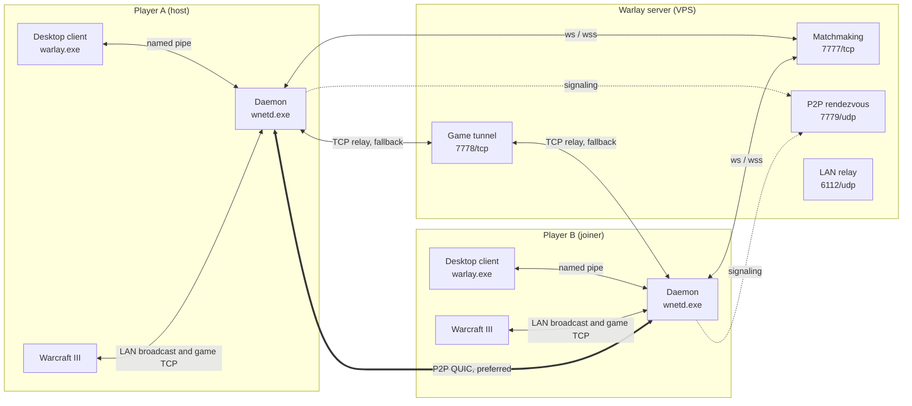
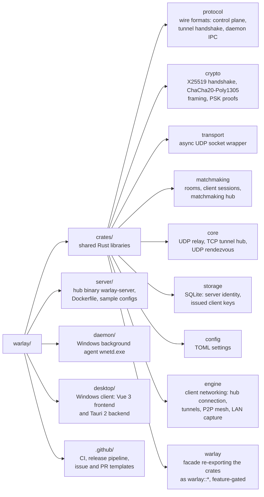
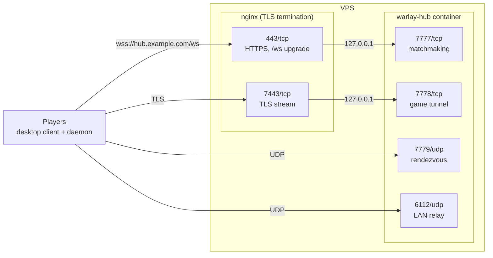

<div align="center">

# Warlay

**Play Warcraft III LAN games with people who are not on your network**<br/>
No third-party VPN, no port forwarding on the players' side.

[](https://github.com/jhonsferg/warlay/actions/workflows/ci.yml)
[](https://github.com/jhonsferg/warlay/releases/latest)
[](LICENSE)

[](https://www.rust-lang.org)
[](https://tokio.rs)
[](https://tauri.app)
[](https://vuejs.org)
[](https://www.typescriptlang.org)
[](https://vite.dev)
[](https://pinia.vuejs.org)
[](https://sass-lang.com)
[](https://www.sqlite.org)
[](https://www.docker.com)
[](https://github.com/features/actions)

[](#downloads)
[](#downloads)

</div>

Warlay pairs a small server you run on a VPS with a Windows desktop client.
Players register the server, create or join rooms in real time, and Warlay
makes the host's game show up in everyone's in-game _Local Area Network_
screen, then carries the real game session either directly between players
(P2P over QUIC) or through the server as a fallback.

## Contents

- [Features](#features)
- [How it works](#how-it-works)
- [Downloads](#downloads)
- [Quick start](#quick-start)
- [Repository layout](#repository-layout)
- [Building from source](#building-from-source)
- [Installing the desktop client](#installing-the-desktop-client)
- [Deploying the server on a VPS](#deploying-the-server-on-a-vps)
- [Operating the server](#operating-the-server)
- [Testing](#testing)
- [Releases](#releases)
- [Contributing](#contributing)
- [License](#license)

## Features

- **Rooms in real time** - create, list, join and password-protect rooms;
  every change is pushed over WebSocket, no polling.
- **Real LAN discovery** - the host's actual W3GS broadcast is captured off
  the wire and replayed on each player's network, so the game lists it exactly
  as if everyone shared a LAN.
- **Game-session tunnel** - direct peer-to-peer QUIC with NAT hole punching,
  falling back automatically to a TCP relay through the server.
- **Secure by default** - per-session X25519 + ChaCha20-Poly1305 encryption on
  the control plane, server-issued client keys, and optional TLS (`wss://`)
  for both the control plane and the game tunnel.
- **Text and voice chat** - room chat, private messages, and Opus voice chat
  between room members.
- **Legacy LAN-mesh mode** - bridge broadcast traffic between isolated subnets
  (for example an Android hotspot running the server on Termux).

## How it works



| Component                       | Runs on                             | Role                                                    |
| ------------------------------- | ----------------------------------- | ------------------------------------------------------- |
| [`server/`](server/README.md)   | VPS (Linux, macOS, Windows, Docker) | Matchmaking hub, game-session relay, P2P rendezvous.    |
| [`daemon/`](daemon/README.md)   | Player's PC (Windows, elevated)     | `wnetd.exe`: LAN capture/replay, game tunnel, P2P mesh. |
| [`desktop/`](desktop/README.md) | Player's PC (Windows)               | `warlay.exe`: the user interface (Tauri 2 + Vue 3).     |

### Network ports (server)

| Port | Protocol | Purpose                                       |
| ---- | -------- | --------------------------------------------- |
| 7777 | TCP      | WebSocket matchmaking control plane (`/ws`)   |
| 7778 | TCP      | Game-session tunnel (relay fallback)          |
| 7779 | UDP      | P2P rendezvous (signaling only, no game data) |
| 6112 | UDP      | LAN discovery relay                           |

Behind a TLS reverse proxy the usual mapping is `443 -> 7777` (`wss://`) and
`7443 -> 7778` (TLS tunnel); see [server/README.md](server/README.md#tls-with-a-reverse-proxy).

### Server addresses

The client accepts three address forms:

| Address                     | Transport                                                                                                  |
| --------------------------- | ---------------------------------------------------------------------------------------------------------- |
| `wss://hub.example.com`     | TLS for matchmaking (port 443) and for the game tunnel (port 7443), certificate verified. **Recommended.** |
| `ws://hub.example.com:7777` | Plain WebSocket and plain game tunnel (port 7778).                                                         |
| `hub.example.com:7777`      | Same as `ws://`, kept for compatibility.                                                                   |

## Downloads

Every release on the [Releases page](https://github.com/jhonsferg/warlay/releases/latest) ships:

| Artifact                                         | Platform                                                                      |
| ------------------------------------------------ | ----------------------------------------------------------------------------- |
| `warlay-desktop-vX.Y.Z-windows-x64-setup.exe`    | Windows installer (client + daemon)                                           |
| `warlay-desktop-vX.Y.Z-windows-x64-portable.zip` | Portable client + daemon                                                      |
| `warlay-daemon-vX.Y.Z-windows-x64.zip`           | Daemon only                                                                   |
| `warlay-server-vX.Y.Z-<target>.tar.gz` / `.zip`  | Server for Linux (static x64/ARM64), macOS (Intel/Apple Silicon), Windows x64 |
| `ghcr.io/jhonsferg/warlay-server:X.Y.Z`          | Server Docker image                                                           |
| `SHA256SUMS.txt`                                 | Checksums for every file                                                      |

## Quick start

### Run a server

```sh
docker volume create warlay-data
docker run -d --name warlay-hub --restart unless-stopped   -p 7777:7777/tcp -p 7778:7778/tcp -p 7779:7779/udp -p 6112:6112/udp   -v warlay-data:/app/data   ghcr.io/jhonsferg/warlay-server:latest
```

Players can then register `<server-ip>:7777`. For a production setup with a
domain, TLS and nginx, follow [Deploying the server on a VPS](#deploying-the-server-on-a-vps).

### Play

1. Install `warlay-desktop-...-setup.exe` (or unzip the portable build and
   run `warlay.exe`). Accept the UAC prompt: the daemon needs administrator
   rights to capture LAN traffic.
2. Register the server (`wss://your-domain` or `host:7777`).
3. Create a room, or join one, and start Warcraft III from the room panel.
4. The host creates the game in _Local Area Network_; it appears for every
   room member.

## Repository layout



The binaries (`server`, `daemon`, `desktop/src-tauri`) stay thin: protocol,
crypto and networking logic live in `crates/` and are consumed through the
`warlay` facade with only the features each binary needs. The server never
links the Windows-only `engine` crate.

## Building from source

### Prerequisites

| Tool                                                                                    | Needed for                       | Notes                                                                      |
| --------------------------------------------------------------------------------------- | -------------------------------- | -------------------------------------------------------------------------- |
| [Rust](https://rustup.rs) stable                                                        | everything                       | On Windows use the default `x86_64-pc-windows-msvc` toolchain.             |
| [Visual Studio Build Tools](https://visualstudio.microsoft.com/visual-cpp-build-tools/) | daemon, desktop client (Windows) | Workload **Desktop development with C++** (MSVC compiler and Windows SDK). |
| [Node.js](https://nodejs.org) 20 LTS or newer                                           | desktop client                   | Ships with `npm`.                                                          |
| [WebView2 Runtime](https://developer.microsoft.com/microsoft-edge/webview2/)            | running the desktop client       | Preinstalled on Windows 10 and 11.                                         |
| C toolchain (`build-essential` on Debian/Ubuntu, Xcode Command Line Tools on macOS)     | server on Linux/macOS            | Compiles the bundled SQLite and the `ring` crypto library.                 |
| [Docker](https://docs.docker.com/engine/install/)                                       | container image                  | Optional.                                                                  |

Nothing else is required: NSIS (the installer builder) is downloaded by the
Tauri CLI on first use, SQLite is compiled in, and the Opus voice codec is
linked statically from prebuilt libraries.

```sh
git clone https://github.com/jhonsferg/warlay.git
cd warlay
```

### Desktop client and daemon (Windows)

The client (`warlay.exe`) bundles the daemon (`wnetd.exe`) as a Tauri
sidecar, so a single build produces both.

**Development mode** - hot-reloading frontend on top of a debug build:

```powershell
cd desktop
npm ci
npm run prepare-daemon-sidecar   # builds wnetd.exe into src-tauri/binaries/
npm run tauri dev
```

**Installer** - a release build of the frontend, the daemon and the client,
packaged as an NSIS installer:

```powershell
cd desktop
npm ci
npx tauri build
```

`tauri build` runs `npm run build` (type-check and bundle the frontend) and
`npm run prepare-daemon-sidecar` (release build of the daemon) before
compiling the client. The results are in `target/release/` at the repository
root:

| Path                                                    | Content                                   |
| ------------------------------------------------------- | ----------------------------------------- |
| `target/release/bundle/nsis/Warlay_X.Y.Z_x64-setup.exe` | Installer (client + daemon + uninstaller) |
| `target/release/warlay.exe`                             | Desktop client                            |
| `target/release/wnetd.exe`                              | Daemon                                    |

**Portable build** - a zip with `warlay.exe`, `wnetd.exe` and usage notes,
for players who do not want to install anything:

```powershell
npm run build-portable-zip   # after npx tauri build
# -> target/release/bundle/nsis/Warlay_X.Y.Z_x64-portable.zip
```

**Daemon only:**

```powershell
cargo build --release -p daemon   # -> target/release/wnetd.exe
```

Binaries link the MSVC runtime statically, so they run on a clean Windows
installation. The version comes from `desktop/src-tauri/tauri.conf.json`
(installer and zip names) and the workspace `Cargo.toml`; the release
pipeline stamps both automatically.

> [!NOTE]
> The installer is not code-signed, so Windows SmartScreen shows a warning
> on first run (**More info > Run anyway**). To sign it, configure
> `bundle.windows.certificateThumbprint` in `tauri.conf.json` with your
> code-signing certificate.

### Server binary

The server builds on Linux, macOS and Windows:

```sh
cargo build --release -p server
# -> target/release/warlay-server (warlay-server.exe on Windows)
```

**Static Linux binary** - runs on any distribution regardless of its glibc
version, which is what the release archives ship. Build it with
[cross](https://github.com/cross-rs/cross) (needs Docker):

```sh
cargo install cross --locked
cross build --release -p server --target x86_64-unknown-linux-musl
cross build --release -p server --target aarch64-unknown-linux-musl   # ARM64 servers
# -> target/<target>/release/warlay-server
```

### Server container image

The image is built from the repository root, because the server depends on
the workspace crates:

```sh
docker build -t warlay-hub -f server/Dockerfile .
```

It uses `cargo-chef` to cache dependency builds and a distroless, non-root
runtime that contains only the stripped binary and `config/hub.toml`.
Building needs more than 1 GiB of RAM; on a small VPS, build on your own
machine and transfer the image:

```sh
docker save warlay-hub | gzip | ssh user@your-vps 'gunzip | docker load'
```

Every release also publishes the image as
`ghcr.io/jhonsferg/warlay-server:<version>` and `:latest`.

## Installing the desktop client

1. Download `warlay-desktop-vX.Y.Z-windows-x64-setup.exe` from the
   [latest release](https://github.com/jhonsferg/warlay/releases/latest) and
   run it (or unzip the portable build anywhere and run `warlay.exe`).
2. On first launch Windows asks for administrator permission for
   `wnetd.exe`. Accept it: the daemon needs elevation to capture LAN game
   broadcasts. The client starts the daemon every time it opens.
3. Register a server with the **+** button in the server rail, using the
   address its operator gave you, for example `wss://hub.example.com`.
4. Set the Warcraft III executable in **Settings**, then create or join a
   room.

Optional: to start the daemon at logon without opening the client, run
`wnetd.exe --install` from an elevated terminal in the installation folder
(`wnetd.exe --uninstall` removes it). Settings and logs are stored in
`%APPDATA%\com.warlay.lanlauncher\`. Uninstall from **Settings > Apps**; the
uninstaller stops the daemon first.

## Deploying the server on a VPS

This walkthrough deploys the hub with Docker behind nginx, with a domain
name and Let's Encrypt certificates, so players connect with
`wss://hub.example.com`. Replace `hub.example.com` with your own domain
throughout.



### 1. Requirements

- A VPS with a public IPv4 address running **Debian 12** or **Ubuntu 22.04+**
  (other distributions work with equivalent commands).
- 1 vCPU and 512 MiB of RAM are enough to run the hub. Building the image
  needs more, so build elsewhere or use the published image.
- A domain name whose DNS you control.
- Root or `sudo` access over SSH.

### 2. Prepare the system

```sh
sudo apt update && sudo apt upgrade -y
sudo apt install -y ufw fail2ban unattended-upgrades curl
sudo dpkg-reconfigure -plow unattended-upgrades   # automatic security updates
```

Use SSH keys and disable password logins (`PasswordAuthentication no` in
`/etc/ssh/sshd_config`) before exposing the server.

### 3. Install Docker

```sh
curl -fsSL https://get.docker.com | sudo sh
sudo systemctl enable --now docker
```

### 4. Point a domain at the VPS

Create DNS records for the hostname players will use:

| Type   | Name              | Value                           |
| ------ | ----------------- | ------------------------------- |
| `A`    | `hub.example.com` | the VPS IPv4 address            |
| `AAAA` | `hub.example.com` | the VPS IPv6 address (optional) |

If your domain already has a wildcard record (`*.example.com`) pointing at
this VPS, any subdomain works without new records. Check propagation before
continuing:

```sh
getent hosts hub.example.com
```

### 5. Configure the firewall

| Port | Protocol | Purpose                                      |
| ---- | -------- | -------------------------------------------- |
| 22   | TCP      | SSH                                          |
| 80   | TCP      | HTTP, Let's Encrypt validation and redirects |
| 443  | TCP      | `wss://` matchmaking through nginx           |
| 7443 | TCP      | TLS game tunnel through nginx                |
| 7779 | UDP      | P2P rendezvous                               |
| 6112 | UDP      | LAN discovery relay                          |

```sh
sudo ufw default deny incoming
sudo ufw default allow outgoing
sudo ufw allow 22/tcp
sudo ufw allow 80/tcp
sudo ufw allow 443/tcp
sudo ufw allow 7443/tcp
sudo ufw allow 7779/udp
sudo ufw allow 6112/udp
sudo ufw enable
```

> [!WARNING]
> Ports published by Docker bypass `ufw`. That is why the next step
> publishes 7777 and 7778 on `127.0.0.1` only: they must be reachable
> exclusively through nginx.

### 6. Run the hub container

Write the server configuration to the host so it survives image updates:

```sh
sudo mkdir -p /opt/warlay
sudo curl -fsSL -o /opt/warlay/hub.toml \
  https://raw.githubusercontent.com/jhonsferg/warlay/main/server/config/hub.toml
sudo chmod 644 /opt/warlay/hub.toml
```

Edit `/opt/warlay/hub.toml`: at least set `server_name` (the name players
see), and optionally `[security] password` to require a password on first
connection. See [server/README.md](server/README.md#configuration) for every
option. Then start the container:

```sh
docker volume create warlay-data
docker run -d --name warlay-hub --restart unless-stopped \
  -p 127.0.0.1:7777:7777/tcp \
  -p 127.0.0.1:7778:7778/tcp \
  -p 7779:7779/udp \
  -p 6112:6112/udp \
  -v warlay-data:/app/data \
  -v /opt/warlay/hub.toml:/app/config/hub.toml:ro \
  ghcr.io/jhonsferg/warlay-server:latest

docker logs warlay-hub   # "starting warlay-server (hub mode)"
```

The `warlay-data` volume holds `warlay.db`, the server identity and every
issued client key. Never run the container without it, or players have to
register again after every update.

### 7. Install nginx and the stream module

```sh
sudo apt install -y nginx libnginx-mod-stream certbot
```

`libnginx-mod-stream` adds TCP proxying, needed for the TLS game tunnel. If
your nginx is built from source, make sure it was compiled with
`--with-stream --with-stream_ssl_module`. Add a `stream` block at the end of
`/etc/nginx/nginx.conf`, outside the `http` block:

```nginx
stream {
    include /etc/nginx/streams-enabled/*.conf;
}
```

```sh
sudo mkdir -p /etc/nginx/streams-available /etc/nginx/streams-enabled
```

### 8. Obtain a TLS certificate

Serve the ACME challenge over plain HTTP first. Create
`/etc/nginx/sites-available/hub.example.com.conf`:

```nginx
server {
    listen 80;
    listen [::]:80;
    server_name hub.example.com;

    location /.well-known/acme-challenge/ {
        root /var/www/html;
    }

    location / {
        return 301 https://$host$request_uri;
    }
}
```

Enable it and request the certificate:

```sh
sudo ln -s /etc/nginx/sites-available/hub.example.com.conf /etc/nginx/sites-enabled/
sudo nginx -t && sudo systemctl reload nginx
sudo certbot certonly --webroot -w /var/www/html -d hub.example.com \
  --deploy-hook "systemctl reload nginx"
```

The deploy hook reloads nginx after every automatic renewal, so both the
HTTPS and the stream listeners pick up the new certificate without dropping
active games. Verify renewal with `sudo certbot renew --dry-run`.

### 9. Configure nginx for Warlay

Append the HTTPS server to `/etc/nginx/sites-available/hub.example.com.conf`:

```nginx
server {
    listen 443 ssl;
    listen [::]:443 ssl;
    server_name hub.example.com;

    ssl_certificate     /etc/letsencrypt/live/hub.example.com/fullchain.pem;
    ssl_certificate_key /etc/letsencrypt/live/hub.example.com/privkey.pem;
    ssl_protocols TLSv1.2 TLSv1.3;

    # Matchmaking WebSocket. Clients ping every few seconds, the long
    # timeouts only matter for idle sessions.
    location = /ws {
        proxy_pass http://127.0.0.1:7777;
        proxy_http_version 1.1;
        proxy_set_header Upgrade $http_upgrade;
        proxy_set_header Connection "upgrade";
        proxy_set_header Host $host;
        proxy_set_header X-Real-IP $remote_addr;
        proxy_buffering off;
        proxy_read_timeout 1h;
        proxy_send_timeout 1h;
    }

    location / {
        return 404;
    }
}
```

Create `/etc/nginx/streams-available/warlay.conf` for the game tunnel:

```nginx
server {
    listen 7443 ssl;
    listen [::]:7443 ssl;

    ssl_certificate     /etc/letsencrypt/live/hub.example.com/fullchain.pem;
    ssl_certificate_key /etc/letsencrypt/live/hub.example.com/privkey.pem;
    ssl_protocols TLSv1.2 TLSv1.3;

    proxy_pass 127.0.0.1:7778;
    proxy_connect_timeout 5s;
    # A room host's control channel can stay idle for hours.
    proxy_timeout 12h;
    tcp_nodelay on;
}
```

Enable it and reload:

```sh
sudo ln -s /etc/nginx/streams-available/warlay.conf /etc/nginx/streams-enabled/
sudo nginx -t && sudo systemctl reload nginx
```

### 10. Verify the deployment

```sh
# WebSocket upgrade through nginx: expect "HTTP/1.1 101 Switching Protocols"
curl -si --http1.1 -m 5 \
  -H "Connection: Upgrade" -H "Upgrade: websocket" \
  -H "Sec-WebSocket-Version: 13" -H "Sec-WebSocket-Key: dGhlIHNhbXBsZSBub25jZQ==" \
  https://hub.example.com/ws | head -1

# TLS game tunnel: expect "Verify return code: 0 (ok)"
timeout 5 openssl s_client -connect hub.example.com:7443 -servername hub.example.com </dev/null 2>/dev/null \
  | grep "Verify return code"

# Hub logs
docker logs --tail 20 warlay-hub
```

Players can now register `wss://hub.example.com` in the desktop client.

### Alternative: without a domain

For a quick test or a private server, skip nginx and TLS and publish the
ports directly. Players then register `<vps-ip>:7777` (no transport
encryption beyond the built-in session encryption, see
[SECURITY.md](SECURITY.md)):

```sh
sudo ufw allow 7777/tcp && sudo ufw allow 7778/tcp
docker run -d --name warlay-hub --restart unless-stopped \
  -p 7777:7777/tcp -p 7778:7778/tcp -p 7779:7779/udp -p 6112:6112/udp \
  -v warlay-data:/app/data \
  ghcr.io/jhonsferg/warlay-server:latest
```

### Alternative: without Docker (systemd)

Download `warlay-server-vX.Y.Z-x86_64-unknown-linux-musl.tar.gz` (or the
`aarch64` one for ARM servers) from the releases page, then:

```sh
sudo useradd --system --home /opt/warlay --shell /usr/sbin/nologin warlay
sudo mkdir -p /opt/warlay/data
sudo tar -xzf warlay-server-v*-x86_64-unknown-linux-musl.tar.gz -C /opt/warlay --strip-components=1
sudo sed -i 's|^data_dir = .*|data_dir = "/opt/warlay/data"|' /opt/warlay/config/hub.toml
sudo sed -i 's|^ws_addr = .*|ws_addr = "127.0.0.1:7777"|; s|^tcp_tunnel_addr = .*|tcp_tunnel_addr = "127.0.0.1:7778"|' \
  /opt/warlay/config/hub.toml
sudo chown -R warlay:warlay /opt/warlay
```

Create `/etc/systemd/system/warlay.service`:

```ini
[Unit]
Description=Warlay hub
After=network-online.target
Wants=network-online.target

[Service]
User=warlay
Group=warlay
WorkingDirectory=/opt/warlay
ExecStart=/opt/warlay/warlay-server hub --config /opt/warlay/config/hub.toml
Restart=on-failure
NoNewPrivileges=true
ProtectSystem=strict
ProtectHome=true
ReadWritePaths=/opt/warlay/data

[Install]
WantedBy=multi-user.target
```

```sh
sudo systemctl daemon-reload
sudo systemctl enable --now warlay
journalctl -u warlay -f
```

The nginx, certificate and firewall steps are the same as above.

## Operating the server

**Update to a new release:**

```sh
docker pull ghcr.io/jhonsferg/warlay-server:latest
docker rm -f warlay-hub
# re-run the same `docker run` command from step 6
```

The data volume and the config file are untouched, so players keep their
registration.

**Back up and restore the data volume:**

```sh
docker run --rm -v warlay-data:/data -v "$PWD":/backup busybox \
  tar -czf /backup/warlay-data-$(date +%F).tar.gz -C /data .

docker run --rm -v warlay-data:/data -v "$PWD":/backup busybox \
  tar -xzf /backup/warlay-data-YYYY-MM-DD.tar.gz -C /data
```

**Change the configuration:** edit `/opt/warlay/hub.toml` and run
`docker restart warlay-hub`. Set `log_level = "debug"` temporarily to trace
tunnel pairing and relays.

**Troubleshooting:**

| Symptom                                                    | Likely cause and fix                                                                                    |
| ---------------------------------------------------------- | ------------------------------------------------------------------------------------------------------- |
| The client cannot connect to `wss://hub.example.com`       | Port 443 blocked, nginx not reloaded, or the certificate does not cover the hostname. Run step 10.      |
| Rooms work but joining a game never connects               | Port 7443/tcp (TLS tunnel) or 7779/udp (rendezvous) blocked by the firewall or the provider's firewall. |
| The host's game does not appear in _Local Area Network_    | The daemon is not running elevated on the host's PC. Restart the client and accept the UAC prompt.      |
| Port 7777 or 7778 reachable from the internet behind nginx | Docker publishes ports past `ufw`. Bind them to `127.0.0.1` as in step 6.                               |
| Every player has to register again after an update         | The container was started without the `warlay-data` volume.                                             |

Many VPS providers also have a firewall in their control panel; open the
same ports there.

## Testing

```sh
# Server and shared crates (any OS)
cargo test -p server -p protocol -p crypto -p matchmaking -p core -p storage -p config -p transport

# Whole workspace (Windows; the daemon's test binary requires an elevated shell)
cargo test --workspace

# Frontend type-check and bundle
cd desktop && npm run build

# Live tests against a deployed hub (opt-in)
cargo test -p engine -- --ignored
```

## Releases

Releases are fully automated. `main` is protected, and every pull request
merged into it triggers the [release workflow](.github/workflows/release.yml),
which:

1. computes the next [SemVer](https://semver.org) version from the
   [Conventional Commits](https://www.conventionalcommits.org) since the last
   tag (`feat` -> minor, `fix` and others -> patch, breaking -> major),
2. builds the server for five targets and the Windows client, daemon and
   installer with that version stamped in,
3. pushes the server image to GHCR,
4. tags the commit and publishes a GitHub Release with notes and checksums.

## Contributing

Contributions are welcome. Please read [CONTRIBUTING.md](CONTRIBUTING.md) and
our [Code of Conduct](CODE_OF_CONDUCT.md). Report security issues privately as
described in [SECURITY.md](SECURITY.md).

## License

Warlay is released under the [MIT License](LICENSE). Warcraft III is a
trademark of Blizzard Entertainment; this project is not affiliated with or
endorsed by Blizzard.
