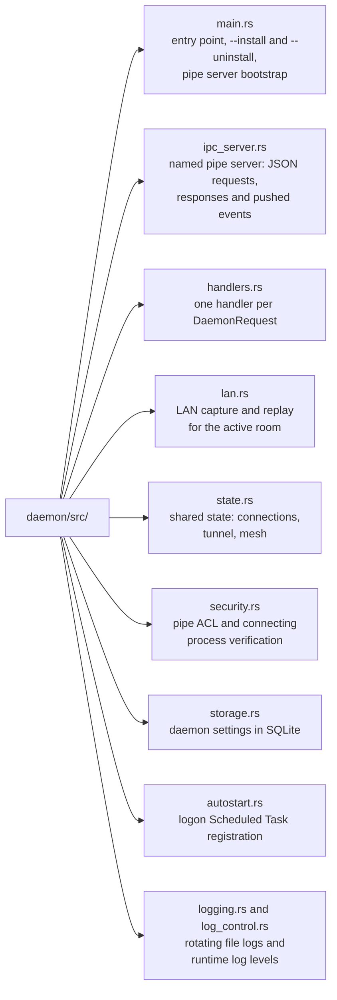

# Warlay daemon (wnetd)

`wnetd.exe` is the Warlay Network Daemon: a Windows background agent that does
everything needing elevated privileges or long-lived sockets, on behalf of the
[desktop client](../desktop/README.md). It has no window; the client talks to
it over a local named pipe.

## Responsibilities

- **Hub connections** - one encrypted matchmaking connection per registered
  server (`ws://`, `wss://` or legacy `host:port`), with ping tracking and
  reconnect notifications.
- **LAN capture and replay** - captures the host's real Warcraft III LAN
  broadcast with a raw `SIO_RCVALL` socket and replays relayed broadcasts on
  joiners' networks.
- **Game-session tunnel** - P2P QUIC mesh between room members with NAT hole
  punching, and the TCP tunnel through the hub (TLS-wrapped for `wss://`
  servers) as fallback.
- **Voice relay** - forwards Opus voice frames between the client and the
  P2P mesh.
- **Game launch** - starts Warcraft III with the user's configured
  executable.

The networking logic lives in [`crates/engine`](../crates/engine); the daemon
wires it to the IPC protocol defined in
[`crates/protocol/src/ipc.rs`](../crates/protocol/src/ipc.rs).

## Source layout



## Usage

The desktop client starts the daemon (elevated) every time it launches, so
most players never run it by hand. To start it at logon instead:

```sh
wnetd.exe              # run the agent (asks for elevation)
wnetd.exe --install    # register auto-start at logon (run as administrator)
wnetd.exe --uninstall  # remove the auto-start task
```

Logs are written to `%APPDATA%\com.warlay.lanlauncher\logs\`.

## Security

The daemon must run as administrator because Windows only allows
`SIO_RCVALL` raw capture to elevated processes. To keep that privilege from
being abused, the pipe is created with an ACL that only admits interactive
users, `SYSTEM` and Administrators, and every connecting process's
executable is verified before requests are accepted (`security.rs`).

## Building

```sh
cargo build --release -p daemon   # -> target/release/wnetd.exe
```

Release builds use the Windows GUI subsystem (no console window) and embed a
manifest requesting elevation (`build.rs`). For a client build, run
`npm run prepare-daemon-sidecar` in `desktop/`, which builds the daemon and
copies it where Tauri bundles it.

## Tests

```sh
cargo test -p daemon    # from an elevated shell: the test binary carries the elevation manifest
```
