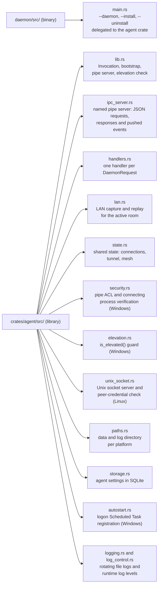

# Warlay daemon (wnetd)

`wnetd.exe` is the Warlay Network Daemon: a Windows background agent that does
everything needing elevated privileges or long-lived sockets, on behalf of the
[desktop client](../desktop/README.md). It has no window; the client talks to
it over a local named pipe.

**This directory is only a thin binary.** The agent itself lives in
[`crates/agent`](../crates/agent), and `daemon/` wraps its entry point in a
few lines so the agent can still be built and run on its own. The player-facing
build does not need that binary: `warlay.exe --daemon` runs the *same library*
in a second process of the client itself (see
[Single binary](#single-binary)), which is why both entry points can never
drift apart.

The agent also builds and runs on Linux (`wnetd`), with the same requests,
handlers and behavior: the IPC endpoint is a Unix socket instead of the named
pipe and LAN capture uses an `AF_PACKET` socket instead of `SIO_RCVALL` (see
[Linux](#linux)).

## Responsibilities

- **Hub connections** - one encrypted matchmaking connection per registered
  server (`ws://`, `wss://` or legacy `host:port`), with ping tracking and
  reconnect notifications.
- **LAN capture and replay** - captures the host's real Warcraft III LAN
  broadcast with a raw `SIO_RCVALL` socket and replays relayed broadcasts on
  joiners' networks.
- **Game-session tunnel** - P2P QUIC mesh between room members with NAT hole
  punching, and the TCP tunnel through the hub (TLS-wrapped for `wss://`
  servers) as fallback.
- **Voice relay** - forwards Opus voice frames between the client and the
  P2P mesh.
- **Game launch** - starts Warcraft III with the user's configured
  executable.

The networking logic lives in [`crates/engine`](../crates/engine); the agent
wires it to the IPC protocol defined in
[`crates/protocol/src/ipc.rs`](../crates/protocol/src/ipc.rs).

## Source layout



## Single binary

One PE carries one manifest, so `warlay.exe` ships with a
`requireAdministrator` manifest written in
[`desktop/src-tauri/windows-app-manifest.xml`](../desktop/src-tauri/windows-app-manifest.xml)
and the agent inherits that elevation without any extra step:

1. Windows refuses to start `warlay.exe` unelevated, so the second instance
   it spawns is elevated too.
2. The client checks whether an agent is answering the pipe on startup and,
   if not, launches **itself** with `--daemon` (via `ShellExecuteExW`'s
   `runas` verb, which stays as a safety net for callers that somehow are not
   elevated).
3. `warlay.exe --daemon` runs the agent before Tauri, its webview, tray,
   tracing subscriber or panic hook get a chance to touch anything: the agent
   owns all of those process-wide, and a second subscriber would panic.
4. As a last line of defence,
   [`elevation::is_elevated()`](../crates/agent/src/elevation.rs) refuses to
   open the pipe when the token is not elevated, so the failure surfaces as
   "the agent is not responding" instead of a game that silently misses
   broadcasts.

Consequences worth knowing: the client runs elevated (it inherits the same
manifest), and so does the Warcraft III process it launches. The standalone
`wnetd.exe` built from this directory keeps its own manifest in
[`daemon/build.rs`](build.rs) and remains useful for development or for
running the agent without the client.

## Usage

The desktop client starts the agent (elevated) every time it launches, so
most players never run anything by hand. To start it at logon instead:

```sh
warlay.exe --install    # register auto-start at logon (run as administrator)
warlay.exe --uninstall  # remove the auto-start task
```

The standalone build understands the same flags (plus running the agent with
no arguments at all):

```sh
wnetd.exe              # run the agent (asks for elevation)
wnetd.exe --daemon     # same, the explicit form warlay.exe uses
wnetd.exe --install    # register auto-start at logon
wnetd.exe --uninstall  # remove the auto-start task
```

Logs are written to `%APPDATA%\com.warlay.lanlauncher\logs\`, one file per
process start.

**Log level.** The default is `info`, which records lifecycle events only:
individual LAN packets are logged at `debug`, and their hex dumps at `trace`
(which is huge: use it to diagnose, then go back). The level can be changed
while the daemon runs, from Ajustes > Registros in the app or with a
`SetAgentSettings` request; it is saved and applied at once, no restart.

**Old logs.** The app deletes log files (its own and the agent's) older than
the retention chosen in Ajustes > Registros, when it starts and every hour
after, and never one that is being written.

**Shutdown.** The agent runs elevated, so the app can't terminate it from
outside. When you quit from the tray icon the app sends `Shutdown`: the
agent drops its hub connections, leaves the room, closes the tunnel and the
LAN capture, answers, and exits; the app waits until it is gone. Closing the
window only hides it and leaves the agent running.

## Security

The agent must run as administrator because Windows only allows
`SIO_RCVALL` raw capture to elevated processes. To keep that privilege from
being abused, the pipe is created with an ACL that only admits interactive
users, `SYSTEM` and Administrators, and every connecting process's
executable is verified before requests are accepted (`security.rs`). That
check resolves the expected client as `warlay.exe` next to the running
agent, which holds for both entry points because both live in that file.

## Building

```sh
cargo build --release -p daemon   # -> target/release/wnetd.exe
```

Release builds use the Windows GUI subsystem (no console window) and embed a
manifest requesting elevation (`build.rs`). No sidecar step exists any more:
the client is built with `npx tauri build` and carries the agent inside it.

## Linux

```sh
cargo build --release -p daemon   # -> target/release/wnetd
sudo ./target/release/wnetd       # or grant it CAP_NET_RAW instead of root
```

|                | Windows                                         | Linux                                                                                                                  |
| -------------- | ----------------------------------------------- | ---------------------------------------------------------------------------------------------------------------------- |
| IPC endpoint   | named pipe `\\.\pipe\warlay-daemon`             | Unix socket: `$WARLAY_DAEMON_SOCKET`, else `$XDG_RUNTIME_DIR/warlay-daemon.sock`, else `/tmp/warlay-daemon-<uid>.sock` |
| Access control | pipe ACL + client executable check              | socket file mode `0600` + `SO_PEERCRED` (same user or root)                                                            |
| LAN capture    | raw socket in `SIO_RCVALL` mode (Administrator) | `AF_PACKET` socket tapping outgoing frames (`CAP_NET_RAW`)                                                             |
| Data and logs  | `%APPDATA%\com.warlay.lanlauncher\`             | `$WARLAY_DATA_DIR`, else `$XDG_DATA_HOME/warlay`, else `~/.local/share/warlay`                                         |
| Shutdown       | Ctrl+C                                          | SIGINT or SIGTERM (`docker stop`, systemd)                                                                             |
| `--install`    | logon Scheduled Task                            | not used: run it from a systemd unit                                                                                   |

The protocol is the same newline-delimited JSON
([`crates/protocol/src/ipc.rs`](../crates/protocol/src/ipc.rs)), so any
client that speaks it can drive either build.

## Tests

```sh
cargo test -p agent    # the agent's library: request parsing, shutdown, IPC
cargo test -p daemon   # the thin wrapper has no tests of its own; nothing to run
```

Neither requires an elevated shell: the bin targets are built with
`test = false`, so the elevation manifest never reaches a test harness.
