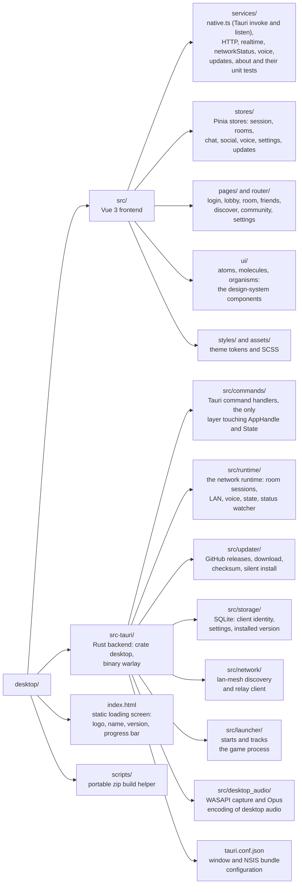
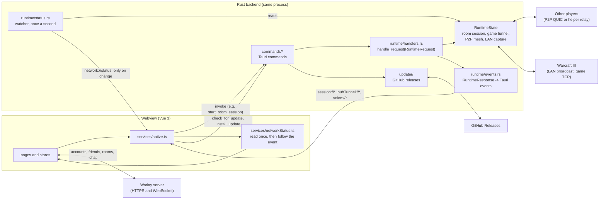

# Warlay desktop client

`warlay.exe` is the Windows application players use: create an account, find
friends, browse and join rooms, chat, talk, and launch Warcraft III. It is a
[Tauri 2](https://tauri.app) app with a Vue 3 + TypeScript frontend and a Rust
backend. The privileged networking (LAN capture, game tunnels, the P2P mesh,
the voice relay) is done by the backend's **network runtime**
(`src-tauri/src/runtime`), inside the same `warlay.exe` process: one
executable does everything.

## Contents

- [Features](#features)
- [Architecture](#architecture)
- [How a room game reaches your LAN screen](#how-a-room-game-reaches-your-lan-screen)
- [Development](#development)
- [Building](#building)
- [Tests](#tests)

## Features

- **Accounts, friends and communities** - sign up, add friends, see who is
  online or in a room, and join communities, all in real time.
- **Rooms** - create, list and join rooms, with a live roster that shows each
  player's **ping**, whether their **microphone is muted**, and who is
  **talking** (a ring around the avatar that follows their volume, plus
  moving bars next to the name, like Meet and Teams).
- **Game launch** - starts Warcraft III with the configured executable and
  arguments once the room's game tunnel is ready.
- **Chat and voice** - room and private text chat (private chats are
  end-to-end encrypted), Opus voice chat in the room (captured and played in
  the webview, sent only while you speak) with a global microphone mute
  shortcut.
- **Settings > Avanzado** - the read-only server address, the log detail level
  and automatic log cleanup (for this app's own logs), **Actualización** and
  **Acerca de Warlay**.
- **Self-update** - Avanzado > Actualización looks for a newer release on
  GitHub (and shows when it last checked) and, with one click, downloads the
  installer, checks it against the release's `SHA256SUMS.txt`, runs it
  silently and restarts into the new version, like Discord. Only files
  published by this repository's releases are downloaded. A portable copy
  cannot replace itself, so it is sent to the release page instead.
- **About** - name, version, build (short commit), release date and when this
  version was installed or last updated.

## Architecture



How the pieces talk at runtime - everything below runs inside the one
`warlay.exe` process:



The frontend talks to the main server over HTTPS and WebSocket (accounts,
friends, rooms, chat) and to the backend only through Tauri commands. The
commands that drive the network (`start_room_session`, `start_game_tunnel`,
`update_room_helper`, `stop_room_session`) build a `RuntimeRequest` (see
`crates/protocol/src/ipc.rs`) and call `runtime::handlers::handle_request`
directly, in the same process. The runtime keeps its state in `RuntimeState`
and pushes events back (`TunnelStatusChanged`, game started/ended, voice
frames, ...) through `runtime/events.rs`, which emits them to the frontend as
Tauri events.

The frontend does not poll. The network status (P2P links with their ping,
game tunnel) is read once with `get_network_status`, and `runtime/status.rs`
then emits the `network://status` event only when something changes (ping
jitter under 10 ms is not a change); the room follows it through
`services/networkStatus.ts`.

Who is talking and who is muted travels over the same voice channel as the
audio: a member sends audio frames only while speaking (a voice gate with a
short hangover), and a 3-byte control packet announces mute / unmute / left,
repeated every 2 seconds so late joiners and lost datagrams catch up
(`services/voicePresence.ts`).

On start, the frontend shows a loading screen (logo, name and version over an
indeterminate progress bar, defined in `index.html`) that is dismissed once
the session has been restored and the first route is ready.

## How a room game reaches your LAN screen

Warcraft III discovers LAN games with UDP broadcasts on port 6112 and plays
over TCP. The runtime reproduces both across the internet:

1. **Capture.** `lan_capture` (in `crates/engine`) opens a raw socket per
   local interface in Windows' `SIO_RCVALL` mode - the driver-free technique
   used by tools such as RawCap, needing only `ws2_32.dll` - and forwards the
   real W3GS broadcast bytes to the other players of the room.
2. **Replay.** `lan_rebroadcast` replays those exact bytes on each player's
   local network, so the game appears in _Local Area Network_ with no
   protocol guesswork. Each peer's game is advertised on its own local port,
   so the port a joiner connects to says whose game it is.
3. **Tunnel.** When the joiner's game connects, the runtime carries the TCP
   session over a direct QUIC connection between the players (after NAT hole
   punching through the helper's rendezvous service) or, as a fallback,
   through the helper's relay.

`SIO_RCVALL` requires administrator rights, which is why `warlay.exe` carries
a `requireAdministrator` manifest (`src-tauri/build.rs`) and runs elevated as
a whole.

## Development

Requirements: Windows, Rust stable, Node.js 20+.

```sh
npm ci
npm run tauri dev
```

`npm run tauri dev` starts Vite on port 1420 and opens the app against it.
There is nothing else to launch.

Plain `cargo build` of `src-tauri` always targets the dev server URL; use
`npx tauri build` for a binary that embeds the frontend. The client requests
elevation (UAC prompt on every launch), so run it from an elevated shell when
developing features that need the LAN capture.

## Building

```sh
npx tauri build                 # frontend + warlay.exe + NSIS installer
npm run build-portable-zip      # zip with warlay.exe and LEEME.txt
```

Artifacts end up in `../target/release/bundle/nsis/`. Binaries link the MSVC
runtime statically (`src-tauri/.cargo/config.toml`), so they run on a clean
Windows install; they only need the WebView2 runtime, which ships with
Windows 10 and 11. The build stamps the short commit and the build time into
the binary (`src-tauri/build.rs`); they appear in Avanzado > Acerca de.

## Tests

```sh
npm run build                         # vue-tsc type-check + Vite bundle
npm run test:unit                     # frontend unit tests (src/services/*.test.ts)
WARLAY_TEST_MANIFEST=1 cargo test --workspace   # backend unit tests (repo root)
```

`WARLAY_TEST_MANIFEST=1` embeds a non-elevated manifest in the test binaries
(the app's own manifest asks for Administrator, which `cargo test` cannot
satisfy).

The unit tests include a guard (`src/services/noDaemon.test.ts`) that fails if
the old two-process design (a separate background service, its protocol or its settings) ever reappears
anywhere in the repository.
