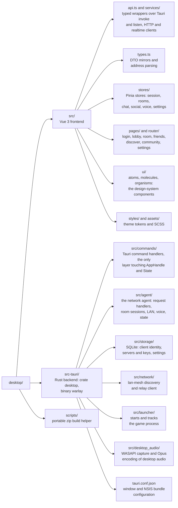

# Warlay desktop client

`warlay.exe` is the Windows application players use: register servers, browse
and join rooms, chat, talk, and launch Warcraft III. It is a
[Tauri 2](https://tauri.app) app with a Vue 3 + TypeScript frontend and a Rust
backend. Privileged networking (LAN capture, game tunnels, hub
connections, voice relay) is done by the **network agent**, which is part of
this same backend (`src-tauri/src/agent`) and runs inside the `warlay.exe`
process. There is no daemon, no second process and no named pipe: one
executable does everything.

## Contents

- [Features](#features)
- [Architecture](#architecture)
- [How a hub game reaches your LAN screen](#how-a-hub-game-reaches-your-lan-screen)
- [Development](#development)
- [Building](#building)
- [Tests](#tests)

## Features

- **Servers rail** - register several hubs (`wss://host`, `ws://host:port` or
  `host:port`) and stay connected to all of them; the server provides its own
  display name during the handshake.
- **Rooms** - create (optionally with a password), list and join rooms in
  real time, with roster, activity log and automatic "in progress" detection.
- **Game launch** - starts Warcraft III with the configured executable and
  arguments once the room's tunnel is ready.
- **Chat and voice** - room and private text chat, Opus voice chat in the
  room (captured and played in the webview) with a global microphone mute
  shortcut.
- **LAN tab** - the legacy lan-mesh flow: scan local subnets, find relay
  bridges, list observed games, and turn this PC into a mesh peer.
- **Agent settings and console** - agent status and settings, live logs,
  log level control.

## Architecture



The frontend only talks to Tauri commands. Commands that need networking
(`connect_to_server`, `start_hosting_tunnel`, `launch_game`, ...) build a
`AgentRequest` (see `crates/protocol/src/ipc.rs`) and call
`agent::handlers::handle_request` directly, in the same process. The agent
keeps its state in `AgentState` and pushes events back (`HubMessage`,
`TunnelStatusChanged`, voice frames, ...) through `agent/events.rs`, which
emits them to the frontend as Tauri events.

The frontend does not poll the agent. The network status (P2P links, game
tunnel, hub connections) is read once with `get_network_status`, and
`agent/status.rs` then emits the `network://status` event only when
something other than uptime changes; the room and the Settings network tab
follow it through `services/networkStatus.ts`.

On start, the frontend shows a loading screen (logo, name and version over an
indeterminate progress bar, defined in `index.html`) that is dismissed once
the session has been restored and the first route is ready.

## How a hub game reaches your LAN screen

Warcraft III discovers LAN games with UDP broadcasts on port 6112 and plays
over TCP. The agent reproduces both across the internet:

1. **Capture (host).** `lan_capture` (in `crates/engine`) opens a raw socket
   per local interface in Windows' `SIO_RCVALL` mode - the driver-free
   technique used by tools such as RawCap, needing only `ws2_32.dll` - and
   forwards the host's real W3GS broadcast bytes to the room.
2. **Replay (joiners).** `lan_rebroadcast` replays those exact bytes on each
   joiner's local network, so the game appears in _Local Area Network_ with
   no protocol guesswork.
3. **Tunnel.** When the joiner's game connects, the agent carries the TCP
   session either over a direct QUIC connection between the players (after
   NAT hole punching through the hub's rendezvous service) or, as a
   fallback, through the hub's TCP tunnel. With a `wss://` server the tunnel
   is TLS-wrapped and the server certificate is verified.

`SIO_RCVALL` requires administrator rights, which is why `warlay.exe` carries
a `requireAdministrator` manifest (`src-tauri/build.rs`) and runs elevated as
a whole; joiners only replay and connect, but run the same code.

## Development

Requirements: Windows, Rust stable, Node.js 20+.

```sh
npm ci
npm run tauri dev
```

`npm run tauri dev` starts Vite on port 1420 and opens the app against it.
The agent runs inside the client, so there is nothing else to launch.

Plain `cargo build` of `src-tauri` always targets the dev server URL; use
`npx tauri build` for a binary that embeds the frontend. The client requests
elevation (UAC prompt on every launch), so run it from an elevated shell when
developing features that need the LAN capture.

## Building

```sh
npx tauri build                 # frontend + warlay.exe (client and agent) + NSIS installer
npm run build-portable-zip      # zip with warlay.exe and LEEME.txt
```

Artifacts end up in `../target/release/bundle/nsis/`. Binaries link the MSVC
runtime statically (`src-tauri/.cargo/config.toml`), so they run on a clean
Windows install; they only need the WebView2 runtime, which ships with
Windows 10 and 11.

## Tests

```sh
npm run build                         # vue-tsc type-check + Vite bundle
npm run test:unit                     # frontend unit tests (src/services/*.test.ts)
cargo test -p desktop -p protocol     # backend unit tests (from the repo root)
```
