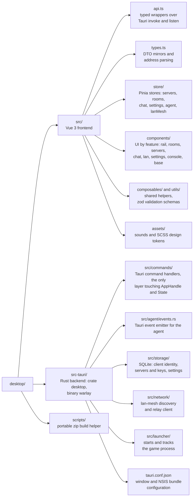

# Warlay desktop client

`warlay.exe` is the Windows application players use: register servers, browse
and join rooms, chat, talk, and launch Warcraft III. It is a
[Tauri 2](https://tauri.app) app with a Vue 3 + TypeScript frontend and a Rust
backend. Privileged networking (LAN capture, game tunnels) runs in the
network agent ([`crates/agent`](../crates/agent)), which the client talks to
over a named pipe and starts as a second instance of itself with
`warlay.exe --daemon` - one binary for both roles (see
[daemon/README.md](../daemon/README.md)).

## Contents

- [Features](#features)
- [Architecture](#architecture)
- [How a hub game reaches your LAN screen](#how-a-hub-game-reaches-your-lan-screen)
- [Development](#development)
- [Building](#building)
- [Tests](#tests)

## Features

- **Servers rail** - register several hubs (`wss://host`, `ws://host:port` or
  `host:port`) and stay connected to all of them; the server provides its own
  display name during the handshake.
- **Rooms** - create (optionally with a password), list and join rooms in
  real time, with roster, activity log and automatic "in progress" detection.
- **Game launch** - starts Warcraft III with the configured executable and
  arguments once the room's tunnel is ready.
- **Chat and voice** - room and private text chat, Opus voice chat in the
  room (captured and played in the webview) with a global microphone mute
  shortcut.
- **LAN tab** - the legacy lan-mesh flow: scan local subnets, find relay
  bridges, list observed games, and turn this PC into a mesh peer.
- **Agent and console views** - agent status and settings, live logs, log
  level control.

## Architecture



The backend never opens hub connections or tunnels itself: commands such as
`connect_to_server`, `start_hosting_tunnel` or `launch_game` are forwarded to
the agent as `DaemonRequest`s (see `crates/protocol/src/ipc.rs`), and the
agent pushes events back (`HubMessage`, `TunnelStatusChanged`, voice
frames, ...), which the backend re-emits to the frontend as Tauri events.

## How a hub game reaches your LAN screen

Warcraft III discovers LAN games with UDP broadcasts on port 6112 and plays
over TCP. The agent reproduces both across the internet:

1. **Capture (host).** `lan_capture` (in `crates/engine`) opens a raw socket
   per local interface in Windows' `SIO_RCVALL` mode - the driver-free
   technique used by tools such as RawCap, needing only `ws2_32.dll` - and
   forwards the host's real W3GS broadcast bytes to the room.
2. **Replay (joiners).** `lan_rebroadcast` replays those exact bytes on each
   joiner's local network, so the game appears in _Local Area Network_ with
   no protocol guesswork.
3. **Tunnel.** When the joiner's game connects, the agent carries the TCP
   session either over a direct QUIC connection between the players (after
   NAT hole punching through the hub's rendezvous service) or, as a
   fallback, through the hub's TCP tunnel. With a `wss://` server the tunnel
   is TLS-wrapped and the server certificate is verified.

`SIO_RCVALL` requires administrator rights, which is why `warlay.exe` carries
a `requireAdministrator` manifest (`src-tauri/build.rs`) and runs elevated as
a whole; joiners only replay and connect, but run the same agent.

## Development

Requirements: Windows, Rust stable, Node.js 20+.

```sh
npm ci
npm run tauri dev
```

`npm run tauri dev` starts Vite on port 1420 and opens the app against it.
The client starts the agent itself when it opens (it runs a second instance
of `warlay.exe --daemon` inside the same process), so there is nothing else
to launch. To run the agent by hand instead:

```sh
cargo run -p desktop -- --daemon   # the desktop binary in agent mode
cargo run -p daemon                  # the standalone agent binary (dev only)
```

Plain `cargo build` of `src-tauri` always targets the dev server URL; use
`npx tauri build` for a binary that embeds the frontend. Both the client and
its agent request elevation (UAC prompt on every launch), so the agent-side
commands need an elevated shell too.

## Building

```sh
npx tauri build                 # frontend + warlay.exe (client and agent) + NSIS installer
npm run build-portable-zip      # zip with warlay.exe and LEEME.txt
```

Artifacts end up in `../target/release/bundle/nsis/`. Binaries link the MSVC
runtime statically (`src-tauri/.cargo/config.toml`), so they run on a clean
Windows install; they only need the WebView2 runtime, which ships with
Windows 10 and 11.

## Tests

```sh
npm run build                         # vue-tsc type-check + Vite bundle
cargo test -p desktop                 # backend unit tests (from the repo root)
```
