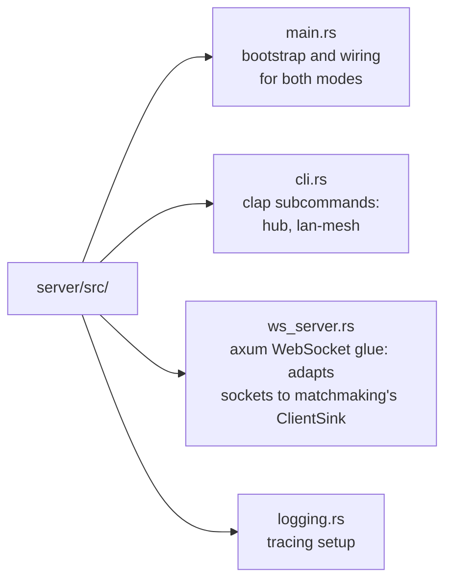

# Warlay server

`warlay-server` is the Warlay hub: the matchmaking server players register in
the desktop client, plus the relay and signaling services that carry their
game sessions. One binary, two modes:

- **`hub`** (main mode) - centralized matchmaking over WebSocket, a TCP tunnel
  for the real game session, P2P rendezvous and a LAN-discovery relay. Runs on
  a public server.
- **`lan-mesh`** (legacy) - broadcast-reflection mesh between physically
  isolated LAN subnets (for example a Termux instance on an Android hotspot),
  with statically configured peers and no central server.

## Contents

- [Running](#running)
- [Configuration](#configuration)
- [Deploying with Docker](#deploying-with-docker)
- [TLS with a reverse proxy](#tls-with-a-reverse-proxy)
- [Architecture](#architecture)
- [Connection security](#connection-security)
- [Persistence](#persistence)
- [LAN-mesh mode](#lan-mesh-mode)
- [Scope and limitations](#scope-and-limitations)

## Running

Download the archive for your platform from the
[latest release](https://github.com/jhonsferg/warlay/releases/latest), or
build it yourself with `cargo build --release -p server`.

```sh
./warlay-server hub --config config/hub.toml

# or with flags only
./warlay-server hub --ws-addr 0.0.0.0:7777 --relay-addr 0.0.0.0:6112 \
  --tcp-tunnel-addr 0.0.0.0:7778 --name "My Warlay hub"
```

Open these ports in your firewall:

| Port | Protocol | Purpose                                             |
| ---- | -------- | --------------------------------------------------- |
| 7777 | TCP      | WebSocket matchmaking control plane (`/ws`)         |
| 7778 | TCP      | Game-session tunnel (relay fallback when P2P fails) |
| 7779 | UDP      | P2P rendezvous (signaling only)                     |
| 6112 | UDP      | LAN discovery relay                                 |

The client derives the tunnel and rendezvous addresses from the host it was
given, so 7778 and 7779 must be reachable on the same host as the
matchmaking endpoint.

## Configuration

`config/hub.toml` (shipped in every archive and in the Docker image):

```toml
server_name = "Warlay VPS #1"          # shown to players in the client

[hub]
ws_addr = "0.0.0.0:7777"
relay_addr = "0.0.0.0:6112"
tcp_tunnel_addr = "0.0.0.0:7778"
rendezvous_udp_addr = "0.0.0.0:7779"
membership_ttl_secs = 30               # prune silent UDP relay members
data_dir = "/app/data"                 # warlay.db lives here
client_inactivity_purge_days = 30      # forget clients that never come back
room_inactivity_purge_minutes = 15     # drop rooms with nobody connected

[security]
# password = "changeme"                # require a password on first connection

[observability]
log_level = "info"                     # "debug" to trace tunnel pairing and relays
```

Run `warlay-server hub --help` for the equivalent command-line flags.

## Deploying with Docker

The image is published to GHCR on every release, or you can build it from
the **repository root** (the server depends on the workspace crates):

```sh
docker build -t warlay-hub -f server/Dockerfile .
```

The [`Dockerfile`](Dockerfile) uses `cargo-chef` to cache dependency builds
and a distroless, non-root runtime image that contains only the stripped
binary and the default config.

```sh
docker volume create warlay-data
docker run -d --name warlay-hub --restart unless-stopped \
  -p 7777:7777/tcp -p 7778:7778/tcp -p 7779:7779/udp -p 6112:6112/udp \
  -v warlay-data:/app/data \
  ghcr.io/jhonsferg/warlay-server:latest
```

Keep the volume: without it, recreating the container discards `warlay.db`
(the server identity and every issued client key) and every player has to
register again.

To ship a locally built image to a server without a registry:

```sh
docker save warlay-hub | gzip | ssh my-server 'gunzip | docker load'
```

Build on a machine with more RAM and cores than a small VPS if you can; a
release build of the workspace needs well over 1 GiB of memory.

## TLS with a reverse proxy

The hub itself speaks plain TCP; terminate TLS in front of it so players can
register the server as `wss://hub.example.com`. A `wss://` client expects:

| Public port | Forward to                   | Protocol                  |
| ----------- | ---------------------------- | ------------------------- |
| 443         | `127.0.0.1:7777`, path `/ws` | HTTPS / WebSocket upgrade |
| 7443        | `127.0.0.1:7778`             | TLS-wrapped TCP stream    |
| 7779        | the hub directly             | UDP                       |

Publish 7777 on loopback only (`-p 127.0.0.1:7777:7777/tcp`) so all
matchmaking traffic goes through the proxy. Keep 7778 public only if you
still need to serve clients registered with a plain `host:port` address.

Example with nginx and a Let's Encrypt certificate:

```nginx
# /etc/nginx/sites-enabled/hub.example.com.conf  (http context)
server {
    listen 443 ssl;
    server_name hub.example.com;

    ssl_certificate     /etc/letsencrypt/live/hub.example.com/fullchain.pem;
    ssl_certificate_key /etc/letsencrypt/live/hub.example.com/privkey.pem;

    location = /ws {
        proxy_pass http://127.0.0.1:7777;
        proxy_http_version 1.1;
        proxy_set_header Upgrade $http_upgrade;
        proxy_set_header Connection "upgrade";
        proxy_set_header Host $host;
        proxy_buffering off;
        proxy_read_timeout 1h;
        proxy_send_timeout 1h;
    }

    location / { return 404; }
}
```

```nginx
# nginx.conf, top level (requires ngx_stream_module)
stream {
    server {
        listen 7443 ssl;
        ssl_certificate     /etc/letsencrypt/live/hub.example.com/fullchain.pem;
        ssl_certificate_key /etc/letsencrypt/live/hub.example.com/privkey.pem;
        ssl_protocols TLSv1.2 TLSv1.3;

        proxy_pass 127.0.0.1:7778;
        proxy_connect_timeout 5s;
        # A host's control channel can sit idle for hours waiting for joiners.
        proxy_timeout 12h;
        tcp_nodelay on;
    }
}
```

When certbot renews the certificate it reloads nginx, and both listeners pick
up the new certificate without dropping active games.

## Architecture



Everything else lives in the shared crates (see the
[repository layout](../README.md#repository-layout)):

- **`protocol`** - wire formats only: `control_ws` (WebSocket JSON
  `ClientMessage`/`ServerMessage`), `hub` (UDP `RelayFrame`), `tunnel`
  (`TunnelHello`), `rendezvous`, and the lan-mesh `control`/`envelope` formats.
- **`matchmaking`** - rooms, the room registry, client sessions and
  `MatchmakingHub`, which interprets client messages and decides what to
  broadcast. It depends only on a `ClientSink` trait and never imports axum,
  which keeps it unit-testable without sockets.
- **`core`** - data-plane engines: `RelayHub` (UDP discovery fan-out),
  `TcpTunnelHub` (game-session tunnel) and `UdpRendezvous` (P2P signaling),
  plus lan-mesh's `PeerRegistry`, `LoopGuard`, `RelayEngine` and
  `ControlResponder`.
- **`crypto`**, **`storage`**, **`config`**, **`transport`** - see below.

### Hub listeners

- **WebSocket control plane** (`ws_addr`, path `/ws`) - after the handshake
  (see [Connection security](#connection-security)) the client authenticates
  and sends `createRoom`, `joinRoom`, `leaveRoom`, chat messages, `ping`, and
  so on. The server pushes `roomList`, `roomCreated`, `roomUpdated` and
  `roomRemoved` to every client in real time.
- **TCP game-session tunnel** (`tcp_tunnel_addr`) - carries the real WC3
  game connection when P2P is not possible. Each connection starts with a
  length-prefixed `TunnelHello`:
  - `HostControl { room_token }` - the host keeps one open per room as a
    signaling channel.
  - `JoinerStream { room_token }` - one per WC3 connection on a joiner.
  - `HostBackend { room_token }` - opened by the host after reading a `0x01`
    byte on its control channel ("a joiner is waiting"). The hub pairs it
    FIFO with the oldest waiting `JoinerStream` and copies bytes both ways,
    without knowing anything about the game protocol.
- **UDP rendezvous** (`rendezvous_udp_addr`) - room members register their
  observed public endpoint; the hub replies with the other members' endpoints
  so they can attempt a direct QUIC connection (NAT hole punching). It never
  carries game bytes, and its failure only means sessions fall back to the
  TCP tunnel.
- **UDP relay** (`relay_addr`) - fans `RelayFrame { room_token, payload }`
  datagrams out to the other members of a room, as unicast. Because nothing is
  broadcast there is no self-echo risk, so hub mode needs no `LoopGuard`.

## Connection security

Every WebSocket connection runs a handshake before any `ClientMessage` is
processed:

1. Client sends plaintext `HandshakeHello { client_id, client_ephemeral_pubkey }`.
2. Server replies `HandshakeWelcome { server_id, server_name, requires_password, server_ephemeral_pubkey }`.
3. Both sides run X25519 ECDH and derive, with HKDF, a fresh pair of
   directional ChaCha20-Poly1305 keys. From here every frame is binary
   ciphertext; nonces are per-direction strictly increasing counters, which
   rejects replays. Keys are discarded when the connection closes.
4. The client sends one encrypted `AuthRequest`:
   - `Fresh` - no stored key, and the server needs no password.
   - `Password { password }` - no stored key; only ever sent inside the
     encrypted channel.
   - `Proof { hmac }` - proves possession of a previously issued key with
     `HMAC-SHA256(psk, client_pubkey || server_pubkey)`. Binding the proof to
     this session's ephemeral keys stops it from being replayed elsewhere.
5. The server answers `AuthResponse::Accepted { psk }` (a new key on
   first-time auth) or `Rejected { message, retry_as_new }`. `retry_as_new`
   lets a client whose key was purged re-register without asking the user for
   anything unless a password is required.

**Threat model.** This protects against passive eavesdroppers and gives
forward secrecy per connection. On its own it is not a PAKE and does not
authenticate the server, so it does not stop an active man-in-the-middle
during the key exchange. Deploy behind TLS (see
[TLS with a reverse proxy](#tls-with-a-reverse-proxy)) and have players use a
`wss://` address to close that gap: the client then verifies the server
certificate for both the control plane and the game tunnel.

## Persistence

`data_dir` holds `warlay.db` (SQLite, compiled in): the server's own
`server_id`, generated on first boot, and every client's issued key, indexed
by the client's persistent `client_id`. A background task purges clients not
seen for `client_inactivity_purge_days` every hour; a purged client's next
connection looks like a first-time one.

## LAN-mesh mode

```sh
./warlay-server lan-mesh --bind 0.0.0.0:6112 --control 0.0.0.0:6116 \
  --peer <peer-ip>:6112 --name laptop-bridge
# or
./warlay-server lan-mesh --config config/default.toml
```

Each node relays only what it captured locally to every configured peer, and
never re-forwards inbound peer traffic, which keeps an N-node mesh loop-free.
`LoopGuard` fingerprints self-injected payloads for a short TTL to suppress
the one real loop: the OS delivering a node's own re-broadcast back to its
own socket.

On Termux (Android, ARM64):

```sh
pkg install rust
cargo build --release -p server
./target/release/warlay-server lan-mesh --config server/config/default.toml
```

Grant Termux a wake lock (`termux-wake-lock`) and disable battery
optimizations so the bridge keeps running with the screen off.

## Scope and limitations

- **lan-mesh** solves broadcast discovery across subnets where unicast routing
  already works and only broadcast is blocked (AP client isolation, routed
  subnets). It does not proxy the game's TCP session; that would need a
  TUN/TAP interface, which is out of scope for a userspace relay.
- **hub** solves discovery and the game session for Warcraft III: the client
  captures the host's real LAN broadcast and replays it for the other members,
  and the game connection travels over P2P QUIC or the TCP tunnel.

## Tests

```sh
cargo test -p server -p protocol -p crypto -p matchmaking -p core -p storage -p config -p transport
```
